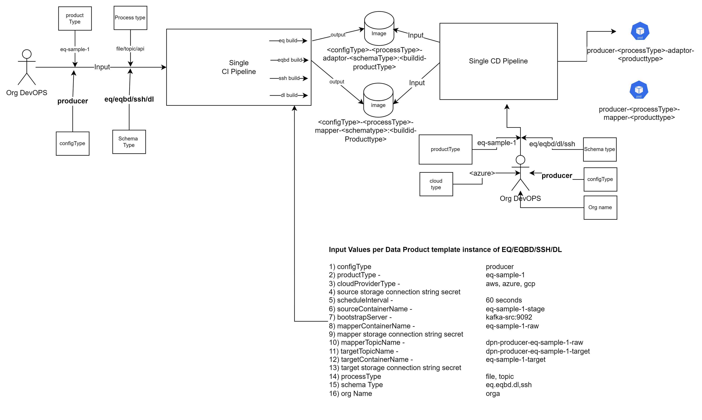
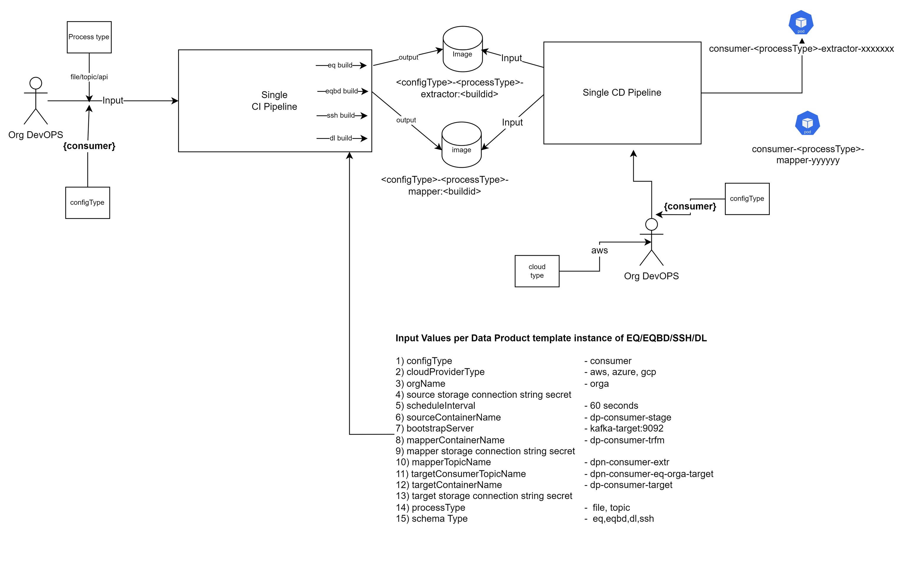
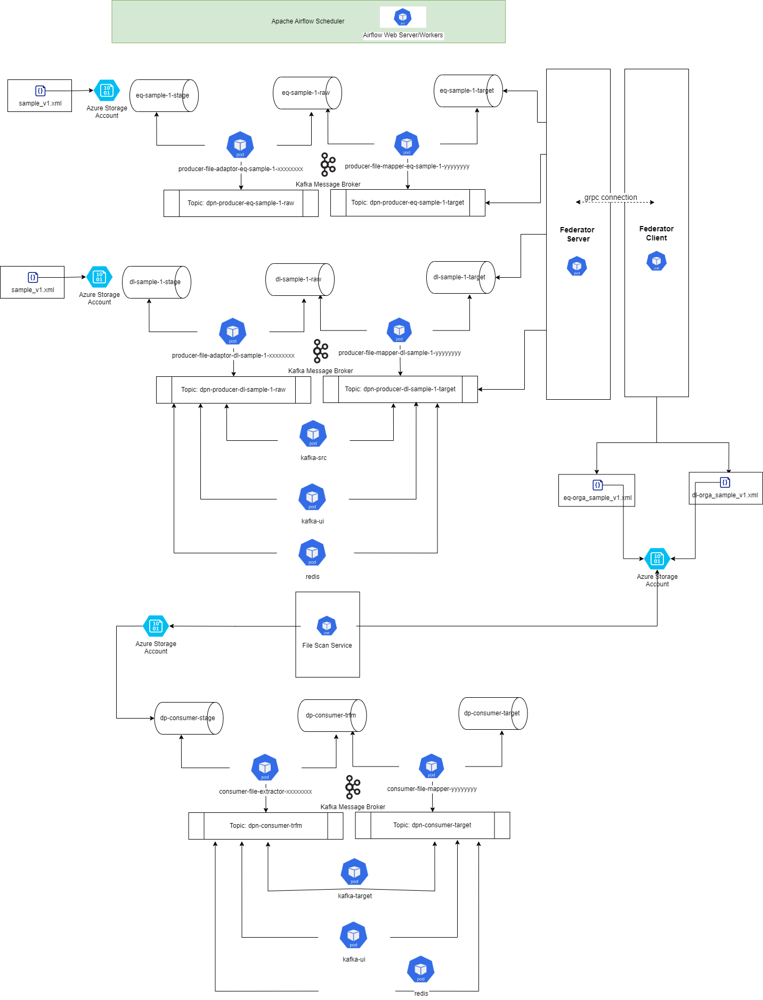

# DPN Data Pipeline Installation Process

---

## Table of Contents

- [Overview](#overview)
- [Step1: Installation Prerequisites](#step1-installation-prerequisites)
  - [Step1a. Clone and Prepare Source Repositories](#step1a-clone-and-prepare-source-repositories)
  - [Step1b. Prepare Infrastructure and Application Prerequisites](#step1b-prepare-infrastructure-and-application-prerequisites)
  - [Step1c. Identify Pipeline Repository Structure](#step1c-identify-pipeline-repository-structure)
  - [Step1d. Configure Environment Approval Gates](#step1d-configure-environment-approval-gates)
- [Step2: Install DPN Data Pipeline](#step2-install-dpn-data-pipeline)
  - [Step2a. Data Pipeline CI (component source repository)](#step2a-data-pipeline-ci-component-source-repository)
  - [Step2b. Validate the Built Image](#step2b-validate-the-built-image)
  - [Step2c. Execute Data Pipeline CD Workflow](#step2c-execute-data-pipeline-cd-workflow)
  - [Step2d. Verify Deployed Containers](#step2d-verify-deployed-containers)
  - [Step2e. Validate Data Pipeline CD Workflow](#step2e-validate-data-pipeline-cd-workflow)
- [Step3: (Optional) Deploy the Scheduler Backend Using Apache Airflow](#step3-optional-deploy-the-scheduler-backend-using-apache-airflow)
  - [Step3a. Verify Prerequisites](#step3a-verify-prerequisites)
  - [Step3b. Execute Airflow CD Workflow](#step3b-execute-airflow-cd-workflow)
  - [Step3c. Verify CD Workflow Execution](#step3c-verify-cd-workflow-execution)
- [Step4: Troubleshooting](#step4-troubleshooting)
  - [CI Pipeline Failure](#ci-pipeline-failure)
  - [Container Image Not Found](#container-image-not-found)
  - [Image Pull Failures](#image-pull-failures)
  - [Data Pipeline Image Tag Malformed](#data-pipeline-image-tag-malformed)
  - [Pods Not Starting](#pods-not-starting)
  - [Data Pipeline Pod Overwritten by Its Sibling Stage](#data-pipeline-pod-overwritten-by-its-sibling-stage)
  - [Container CrashLoopBackOff](#container-crashloopbackoff)
  - [HPA Not Scaling](#hpa-not-scaling)
  - [TRUSTSTORE_PASSWORD / Kafka TLS Handshake Errors](#truststore_password--kafka-tls-handshake-errors)
  - [Kafka Topic Issues](#kafka-topic-issues)
- [Step5: Containerized Deployment Using DSI Provided Container Images](#step5-containerized-deployment-using-dsi-provided-container-images)
  - [Platform & Third-Party Images](#platform--third-party-images)
- [Review Notes](#review-notes)

---

## Overview

This document provides step-by-step instructions for installing and deploying **DPN Data Pipeline component** using the **`dpn-containerised-deployment-service` GitHub Actions pipeline**.

The deployment uses the following repositories:

- https://github.com/energy-dsi/dpn-data-pipelines.git

The deployment process consists of:

- **Continuous Integration (CI)** — builds container images
- **Continuous Deployment (CD)** — deploys images into **Amazon Elastic Kubernetes Service (EKS)**

---

## Step1: Installation Prerequisites

The following prerequisites must be completed before beginning the installation process.

### Step1a. Clone and Prepare Source Repositories

Clone the official repositories from GitHub.

```bash
git clone https://github.com/energy-dsi/dpn-data-pipelines.git
```

Switch to the desired branch.

```bash
git checkout main
```

or

```bash
git checkout release/<version>
```

Deployment itself runs directly against the `dpn-containerised-deployment-service` GitHub repository via GitHub Actions — there is no separate push-to-pipeline-repository step.

---

### Step1b. Prepare Infrastructure and Application Prerequisites

Ensure the following prerequisites are completed before deployment:

- EKS cluster provisioned and accessible, with the **metrics-server** add-on running (required for HPA)
- IRSA (IAM Roles for Service Accounts) enabled on the EKS cluster, with a per-stage IAM role created for each file-based adaptor/schema_mapper/extractor's S3 access — see [ServiceAccount / IRSA (AWS only)](../02-configuration/07-configure-dpn-data-pipelines.md#step3a-set-up-producer-helm-charts-for-file-based-pathways) in the Configuration Guide. This replaces static AWS access-key credentials for S3 access
- DPN Streaming Service (Kafka) deployed, with the required topics pre-created (see [DPN Streaming Service (Kafka)](../02-configuration/07-configure-dpn-data-pipelines.md#step9b-configure-streaming-service-kafka) in the Configuration Guide)
- DPN Health Monitoring Service deployed and OTEL collector container is in running state
- Blob/S3 storage containers provisioned for the `file` integration pathway (see [Storage Blob / S3 Configuration](../02-configuration/07-configure-dpn-data-pipelines.md#step9a-storage-blob--s3-configuration))
- Kubernetes secrets provisioned for producer/consumer storage connection strings (see [Secrets Configuration](../02-configuration/07-configure-dpn-data-pipelines.md#step8-configure-secrets))
- Network and firewall rules applied as described in [Network and Ports Configuration](../02-configuration/00-common-dpn-configuration.md#step5-network-and-ports-configuration), including outbound access to `ghcr.io`
- Software prerequisites (GitHub Actions access, GHCR access — see Step2 below)

[Refer to the **Prerequisites** and **Configuration** documentation for details](../01-prerequisites/01-dpn-prerequisites.md)

**Note:** Organisations must review the CI/CD workflow code for the following. 

- If running your own CI, keep only the relevant build, unit test, and image-push steps — DSI's own CI examples include tool usage such as CheckMarx, SonarQube, and JFrog Xray that your organisation may not need
- The container image is appropriate and referred from GHCR repository unless Organisation plans to use a separate image repository on their own
- The config JSON's environment parameters are pointing to correct deployment environment
- The DSM endpoints are correctly pointing to the respective environment
- Required Firewall rules are applied
- Both CI and CD are verified for the above prerequisites before execution

---

### Step1c. Identify Pipeline Repository Structure

All CD workflows and their per-cloud configuration live in `dpn-containerised-deployment-service`:

```
root/
└── .pipelines/
    └── github-actions-pipelines/
      ├── workflows/
      │   ├── dpn-cd-data-pipelines.yml
      │   └── dpn-cd-airflow.yml
      └── config/
          └── aws/<environment>-<cluster>.json
```


### Step1d. Configure Environment Approval Gates

There is no ADO-style approval-check concept for GitHub Actions workflows by default. If you want a manual sign-off before running the CD workflow against a given environment, configure a required reviewer on the corresponding GitHub Environment (`<environment>-<cluster>`).

--

## Step2: Install DPN Data Pipeline

The DPN Data Pipeline is a series of data validation stages processed through the adaptor and mapper components as outlined in the architecture overview above.

The following diagram represents an overview of DPN Producer Data Pipeline CI/CD architecture. 



The following diagram represents an overview of DPN Consumer Data Pipeline CI/CD architecture. 




---

### Step2a. Data Pipeline CI (component source repository)

CI (build, test, and image push to GHCR) for the data pipeline components isn't yet migrated to GitHub Actions in `dpn-data-pipelines` — build images via your own CI process, following the parameter guidance below for what each build needs to produce, or use the DSI-provided prebuilt GHCR images (see [Step5](#step5-containerized-deployment-using-dsi-provided-container-images)).

The same build supports both Producer and Consumer configurations; what you need to produce varies depending on the configuration type:

##### Consumer Configuration

When **Config Type = `consumer`**:

- **Process Type** — Not required
- **Schema Type** — Not required

##### Producer Configuration

When **Config Type = `producer`**:

- **Process Type** — Mandatory. Currently supported value: `file`. (This may be extended in future releases.)
- **Schema Type** — Mandatory. Currently supported values: `eq`, `dl`, `eqbd`, `ssh`. (This list is extensible in future releases.)
- **Product Type** — Mandatory. Must be provided to correctly parameterise the producer build.

Failure to provide Process Type and Schema Type for a producer build will result in an invalid or incomplete image.

> **Notes:**
> - Schema Type and Process Type only apply when `producer` is selected.
> - Future enhancements may introduce additional schema types and process types without changing the overall structure.

---

#### Step2b. Validate the Built Image

Verify that image registry has been updated with the expected image tag.

---

#### Step2c. Execute Data Pipeline CD Workflow

Go to **Actions → DPN CD - Data Pipelines → Run workflow** in `dpn-containerised-deployment-service`, and supply:

| Input | Value |
|---|---|
| `environment` | `dev` / `test` |
| `cluster` | `dpn01` / `dpn02` |
| `cloud` | `aws` |
| `configType` | `producer` or `consumer` |
| `processType` | `file` or `topic` — default `file` |
| `productType` | The product type, e.g. `eq`, `dl`, `eqbd`, `ssh` — default `default` |
| `schemaType` | The schema type — default `default` |
| `imageTag` | The image tag to deploy |

> **Notes:**
> - Organisations must determine which data templates they require for processing. The workflow is generic — it dynamically discovers and Helm-installs every chart matching the `configType`/`processType`/`productType` combination under `dpn-data-pipelines/`.
> - Before running this workflow, confirm the `SCHEDULER_BACKEND` value set on each product's `values.yaml` (`kafka-trigger` for automated, software-triggered scheduling, or `airflow` for orchestrator-driven scheduling — see [Step3](#step3-optional-deploy-the-scheduler-backend-using-apache-airflow))
> - A separate, narrower proof-of-concept workflow (`dpn-cd-data-pipelines-aws-poc.yml`, no `cloud` input — hardcoded to `aws` with its own bespoke Helm logic) also exists in the repository; it is **not** the workflow described here — use the generic `dpn-cd-data-pipelines.yml` above for the standard aws-selectable path, even when targeting AWS.

---

#### Step2d. Verify Deployed Containers

Run the workflow and verify that the containers are deployed on the EKS cluster. There should be the following two containers running per data product file produced, for each template type (`DL`, `EQ`, `EQBD`, or `SSH`) at each integration pathway level on the producer side:

```
producer-{integration type}-adaptor-{data product type}-xxxxxxxx
producer-{integration type}-mapper-{data product type}-yyyyyyyy
```

Similarly, the following containers will be deployed on the consumer side for each data product consumer ID subscribed to a specific data product type:

```
consumer-{integration type}-extractor-{data product type}-{consumer ID}-xxxxxxxx
consumer-{integration type}-mapper-{data product type}-{consumer ID}-xxxxxxxx
```

Example container names post-deployment:

```
producer-file-adaptor-eqbd-xxxxxxxx
producer-file-mapper-eqbd-xxxxxxxx
consumer-file-extractor-xxxxxxxx
consumer-file-mapper-xxxxxxxx
```

---

#### Step2e. Validate Data Pipeline CD Workflow

Once a successful deployment has completed, the DPN Kubernetes cluster should show an output similar to the example below. This example uses selective `eq` and `dl` producer sample data products on the producer side, and an organisation receiving two data products using the schema type and organisation name.

```text
- Product type  : eq-sample-1, dl-sample-1
- Schema type   : eq and dl
- Cloud type    : aws
- Process type  : file
```



```bash
kubectl get pods -n <namespace>
```

Verify clean logs inside the container:

```bash
kubectl logs <pod-name> -n <namespace>
```

---

## Step3: (Optional) Deploy the Scheduler Backend Using Apache Airflow

### Step3a. Verify Prerequisites

- Verify the `SCHEDULER_BACKEND` is set as `kafka-trigger` (automated, software-triggered scheduling using Apache Airflow)
- For an AWS deployment of the Airflow chart itself (`cloudProvider: aws`), confirm the IRSA role referenced by `serviceAccount.irsaRoleArn` exists and that the 4 secrets under `secretsManager.secretPrefix` (`FERNET_KEY`, `WEB_SECRET_KEY`, `AIR_POSTGRES_PASSWORD`, `AIRFLOW_ADMIN_PASSWORD`) are present in AWS Secrets Manager
- Airflow environment configuration must be made for the deployment environment in the following location.

```
dpn-data-pipelines/
└── charts/
    └── airflow/
        ├── values/aws/<environment>-<cluster>.yaml   <- Environment-specific Airflow overrides
        └── dags/
              └── {product_type}.py   <- One DAG per data product using the airflow backend
```

- Confirm a DAG file exists under `charts/airflow/dags/` for every product using `SCHEDULER_BACKEND: kafka-trigger`

### Step3b. Execute Airflow CD Workflow

Go to **Actions → DPN CD - Airflow → Run workflow** in `dpn-containerised-deployment-service`, and supply:

| Input | Value |
|-----------|-------|
| `environment` | `dev` / `test` |
| `cluster` | `dpn01` / `dpn02` |
| `cloud` | `aws` |
| `airflowImageRepository` | Optional — Airflow image path after `ghcr.io/energy-dsi/` (e.g. `1.0.1/dpn-airflow`). Leave blank to use the environment's configured repository |
| `airflowImageTag` | Optional — Airflow image tag. Leave blank to use the environment's configured tag |
| `postgresImageRepository` | Optional — Postgres image path after `ghcr.io/energy-dsi/` (e.g. `1.0.1/postgres`). Leave blank to use the environment's configured repository |
| `postgresImageTag` | Optional — Postgres image tag. Leave blank to use the environment's configured tag |
| `redisImageRepository` | Optional — Redis image path after `ghcr.io/energy-dsi/` (e.g. `1.0.1/redis`). Leave blank to use the environment's configured repository |
| `redisImageTag` | Optional — Redis image tag. Leave blank to use the environment's configured tag |

### Step3c. Verify CD Workflow Execution

- Verify the webserver, scheduler, triggerer, worker, Postgres, and Redis pods are all `Running`:
  
   ```bash
   kubectl get pods -n <namespace> -l app.kubernetes.io/part-of=airflow
   ```

- Confirm each product's DAG is visible in the Airflow UI/webserver

---

## Step4: Troubleshooting

### CI Pipeline Failure

Possible causes:

- Image Registry Authentication/push failure — verify the CI pipeline's credentials have `write:packages` scope on the image registry

- Missing or incorrect Process Type / Schema Type / Product Type parameters when triggering a producer run (see [Producer Configuration](#producer-configuration))

Verify pipeline logs and ensure all credentials and parameters are correct.

---

### Container Image Not Found

Check whether the CI pipeline pushed the image to correct image repository.

If the expected package/tag is not listed, re-run the relevant CI pipeline and ensure it completes without errors before proceeding to the CD pipeline.

---

### Image Pull Failures

If pods show `ImagePullBackOff` or `ErrImagePull`:

- If the image digest is private, confirm the `imagePullSecrets` referenced by the chart exists in the target namespace and contains a valid, non-expired GitHub PAT with `read:packages`.

- Confirm the EKS node group has correct access to the image registry to pull the images

- Confirm the image reference (`imageRegistry`/`imageName`/`imageTag`) matches an actual published tag — a typo here produces the same failure as a genuine access issue.

---

### Data Pipeline Image Tag Malformed

If a data pipeline image tag or repository name is missing its schema/product segment (e.g. it ends in a trailing `-` or `:` instead of the expected `<buildId>-<productType>`), the product's `values.yaml` most likely has `productType` and/or `schemaType` left blank.

Check the affected product's `values.yaml` for both the adaptor and schema_mapper charts:

```bash
grep -E "^productType:|^schemaType:" producer/{file|topic}/<product_type>/{adaptor,schema_mapper}/charts/values.yaml
```
---

### Pods Not Starting

Check pod events to identify scheduling or image pull issues:

```bash
kubectl describe pod <pod-name> -n <namespace>
```

Review the `Events` section at the bottom of the output. Common causes include insufficient node resources, missing Persistent Volume Claims, or image pull errors due to incorrect image credentials

---

### Data Pipeline Pod Overwritten by Its Sibling Stage

If only one pod appears for a product where two are expected (adaptor and schema_mapper), check whether both charts' `values.yaml` files use the same final `name`/`imageName`:

```bash
grep -E "^name:|^imageName:" producer/{file|topic}/<product_type>/{adaptor,schema_mapper}/charts/values.yaml
```

If they match, the two Helm releases are colliding on the same Kubernetes resource name and one is overwriting the other. Give the schema_mapper chart a distinct `-mapper`-suffixed `name`/`imageName` and re-run the CD pipeline for that product.

---

### Container CrashLoopBackOff

A `CrashLoopBackOff` status means the container starts, crashes, and Kubernetes repeatedly attempts to restart it. Check the logs to identify the root cause:

```bash
kubectl logs <pod-name> -n <namespace>
```

Common causes:

- Invalid or missing environment variables — check the Helm values file for typographical errors or missing entries
- Missing secrets or incorrect S3 access credentials — verify all required secrets exist as Kubernetes secrets with the correct names and values
- Kafka topic is not pre-populated — run the Kafka Topic Creator job or manually create topics via the Kafka UI

---

### HPA Not Scaling

If `kubectl get hpa` shows `<unknown>` under `TARGETS`:

- Confirm metrics-server is running: `kubectl get deployment metrics-server -n kube-system`.
- Confirm the affected pods have CPU/memory `requests` set in their Deployment spec — HPA cannot compute a percentage without a request baseline.

If metrics are available but replica count never changes, confirm `hpa.minReplicas`/`hpa.maxReplicas` allow room to scale, and that current load is actually crossing the configured `targetCPUUtilizationPercentage`/`targetMemoryUtilizationPercentage` threshold.

---

### TRUSTSTORE_PASSWORD / Kafka TLS Handshake Errors

If a pod fails to authenticate to Kafka with an error reading the truststore password, confirm the `kafkaOauthSecretName` secret carries the `KC_HTTPS_TRUST_STORE_PASSWORD` key — the previous key name, `UNIVERSAL_DPN_CERT_PASSWORD`, was retired, and a secret still using the old key name will fail to populate `TRUSTSTORE_PASSWORD`. Also confirm the `dpn-tls` secret carries both `ca.crt` and `truststore.jks`, since it is now mounted as a directory at `/etc/kafka/secrets` rather than a single-file `truststore.jks` subPath.

### Kafka Topic Issues

Verify Kafka topics using the Kafka UI:

```
http://kafka-ui:8086
```

Check that:

- The topic exists in both the source and destination Kafka clusters
- The topic name in the data pipeline configuration matches exactly (topic names are case-sensitive)
- There are no consumer group errors shown in the Kafka UI for the data pipeline's consumer group(s)
- For the `topic` pathway specifically, `srcGroupId` values are unique per product and free of stray environment/test suffixes

---

## Step5: Containerized Deployment Using DSI Provided Container Images

This section covers deployment using **custom and 3rd party open source container images** published by DSI to `ghcr.io/energy-dsi` image repository. Organisations using this approach pull DSI-provided images directly rather than building container images via CI pipelines.

Data Pipeline service images are found in GHCR with following name

| Image Name | GHCR Path | Tag |
|---|---|---|
| producer-file-adaptor-eq | `ghcr.io/energy-dsi/producer-file-adaptor-eq` | `e.g. 1.0.0` |
| producer-file-mapper-eq | `ghcr.io/energy-dsi/producer-file-mapper-eq` | `<version>` |
| producer-file-adaptor-eqbd | `ghcr.io/energy-dsi/producer-file-adaptor-eqbd` | `<version>` |
| producer-file-mapper-eqbd | `ghcr.io/energy-dsi/producer-file-mapper-eqbd` | `<version>` |
| producer-file-adaptor-dl | `ghcr.io/energy-dsi/producer-file-adaptor-dl` | `<version>` |
| producer-file-mapper-dl | `ghcr.io/energy-dsi/producer-file-mapper-dl` | `<version>` |
| producer-file-adaptor-ssh | `ghcr.io/energy-dsi/producer-file-adaptor-ssh` | `<version>` |
| producer-file-mapper-ssh | `ghcr.io/energy-dsi/producer-file-mapper-ssh` | `<version>` |
| producer-topic-adaptor-eq | `ghcr.io/energy-dsi/producer-topic-adaptor-eq` | `<version>` |
| producer-topic-mapper-eq | `ghcr.io/energy-dsi/producer-topic-mapper-eq` | `<version>` |
| producer-topic-adaptor-eqbd | `ghcr.io/energy-dsi/producer-topic-adaptor-eqbd` | `<version>` |
| producer-topic-mapper-eqbd | `ghcr.io/energy-dsi/producer-topic-mapper-eqbd` | `<version>` |
| producer-topic-adaptor-dl | `ghcr.io/energy-dsi/producer-topic-adaptor-dl` | `<version>` |
| producer-topic-mapper-dl | `ghcr.io/energy-dsi/producer-topic-mapper-dl` | `<version>` |
| producer-topic-adaptor-ssh | `ghcr.io/energy-dsi/producer-topic-adaptor-ssh` | `<version>` |
| producer-topic-mapper-ssh | `ghcr.io/energy-dsi/producer-topic-mapper-ssh` | `<version>` |
| consumer-file-extractor | `ghcr.io/energy-dsi/consumer-file-extractor` | `<version>` |
| consumer-file-mapper | `ghcr.io/energy-dsi/consumer-file-mapper` | `<version>` |
| consumer-topic-extractor | `ghcr.io/energy-dsi/consumer-topic-extractor` | `<version>0` |
| consumer-topic-mapper | `ghcr.io/energy-dsi/consumer-topic-mapper` | `<version>` |

Image access setup and the workflow trigger are covered in [Step2](#step2-install-dpn-data-pipeline) and [Step3](#step3-optional-deploy-the-scheduler-backend-using-apache-airflow) above — there is no separate GHCR-specific workflow to run, `dpn-cd-data-pipelines.yml` and `dpn-cd-airflow.yml` already deploy from these GHCR images by default.

---

## Review Notes

| Review Date | Last Reviewed By | Status | Semver Version (Major.Minor.Patch) |
|-------------|------------------|--------|-------------------------------------|
| Sep-2026 | DSI Assurance   | Final  | V1.0.0 |
