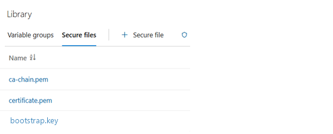

# DPN Vault Service Configuration

This section describes how to configure **DPN HashiCorp Vault service**. HashiCorp Vault is the secret store used by DPN Certificate Manager to hold Intermediate CA, CA chain, key pair, certificate, and keystore/truststore passwords. These secrets are used to build the certificate P12 files for mutual TLS (mTLS).

DSI provides an **automated method** (Azure DevOps pipelines) that generates the required CSR, certificate, and key material and configures Vault end to end. This is the preferred approach for organisations using ADO. A **manual fallback** is also provided for organisations that cannot run the automated pipelines due to certain limitations.

> **Single environment:** These instructions target **one environment/cluster combination** (referred to throughout as `<env>` and `<cluster>`, e.g. `pdev`/`dpn01`). Substitute your own values in the following files present in this location:

 - config file `config/<env>-<cluster>.json`
 - values file `values-<env>-<cluster>.yaml`

 It is not advised to create multiple environment files.

---

## Table of Contents

- [Overview](#overview)
- [Automated Vault Configuration](#automated-vault-configuration)
  - [Step 1: Prerequisites (before Vault can be deployed)](#step-1-prerequisites-before-vault-can-be-deployed)
  - [Step 2: Reference Configuration Data (populate before deployment)](#step-2-reference-configuration-data-populate-before-deployment)
    - [Step 2a. Environment config JSON — `config/<env>-<cluster>.json`](#step-2a-environment-config-json--configenv-clusterjson)
    - [Step 2b. Vault Helm values — `charts/vault-https/values-<env>-<cluster>.yaml`](#step-2b-vault-helm-values--chartsvault-httpsvalues-env-clusteryaml)
  - [Step 3: Deployment Configuration](#step-3-deployment-configuration)
    - [Step 3A: Configure DPN Universal TLS (`dpn-tls-cd`)](#step-3a-configure-dpn-universal-tls-dpn-tls-cd)
    - [Step 3B: Configuration to Initialise Vault (`vault-https-cd`)](#step-3b-configuration-to-initialise-vault-vault-https-cd)
    - [Step 3C: Configure Certificate Bundle (`vault-load-bundle-cd`)](#step-3c-configure-certificate-bundle-vault-load-bundle-cd)
    - [Step 3D: Configure AppRole Authentication (recommended)](#step-3d-configure-approle-authentication-recommended)
- [Manual Vault Configuration (Fallback)](#manual-vault-configuration-fallback)
  - [Step1: Generate the DPN universal TLS material](#step1-generate-the-dpn-universal-tls-material)
  - [Step2: Publish to Azure Key Vault](#step2-publish-to-azure-key-vault)
  - [Step3: Set the non-certificate secrets manually](#step3-set-the-non-certificate-secrets-manually)
  - [Step4: Deploy Vault and create the Kubernetes secrets](#step4-deploy-vault-and-create-the-kubernetes-secrets)
  - [Step5: Initialise Vault and enable KV v2](#step5-initialise-vault-and-enable-kv-v2)
  - [Step6: Load the DSM-signed certificate bundle](#step6-load-the-dsm-signed-certificate-bundle)
  - [Step7: Configure AppRole authentication manually (optional)](#step7-configure-approle-authentication-manually-optional)
  - [Step8: Coordinated restart](#step8-coordinated-restart)
- [Requesting a DPN Server Certificate](#requesting-a-dpn-server-certificate)
  - [How this differs from the Federator Gateway's certificate](#how-this-differs-from-the-federator-gateways-certificate)
  - [Step1: Create a key pair](#step1-create-a-key-pair)
  - [Step2: Create a CSR](#step2-create-a-csr)
  - [Step3: Request the signed server certificate](#step3-request-the-signed-server-certificate)
  - [Certificate properties](#certificate-properties)
  - [Renewal](#renewal)
- [Review Notes](#review-notes)

---

## Overview

HashiCorp Vault stores the cryptographic material the Certificate Manager needs to establish mTLS with the DSI DSM and other DPNs. Certificate Manager reads and writes the following KV v2 paths under the `pki-client` mount:

| Path (`pki-client/node-net/client/…`) | Content | Written by |
|---------------------------------------|---------|------------|
| `keypair` | Client RSA private + public key | Bundle load (Step 3C) |
| `certificate` | DSM-signed client certificate | Bundle load (Step 3C) |
| `ca-chain` | CA chain from DSM | Bundle load (Step 3C) |
| `intermediate-ca` | Intermediate CA certificate | Certificate Manager (renewal) |
| `keystore-password` | Password for the generated `keystore.p12` | Certificate Manager |
| `truststore-password` | Password for the generated `truststore.p12` | Certificate Manager |

Vault serves over **HTTPS (TLS 1.2+)** internally and uses **Azure Key Vault auto-unseal** in the automated approach, so it unseals itself on start-up. In case of manual process the unseal key needs to be created separately. DSI provides the community edition of the Vault container; organisations may substitute an enterprise edition per their licensing strategy.

> **This Vault only stores certificate material — it does not sign certificates.** The `pki-client` mount above is a plain KV v2 secrets engine, not a Vault PKI secrets engine. Signing happens on a **separate** Vault instance run by the DSM Management Node, whose own PKI secrets engine (`pki_int`) holds the CA key material and performs the actual signing when the Certificate Manager submits a CSR. See [Configure DPN Certificate Manager](04-configure-dpn-certificate-manager.md) for the automatic Federator certificate renewal flow, [Requesting a DPN Server Certificate](#requesting-a-dpn-server-certificate) below for the manually-requested long-TTL server/edge certificate signed by that same Management Node PKI engine, and the [DSI Certificate Management UI Guide](../../../05-dpn-user-interfaces/10-dsi-certificate-management-ui-operations.md) for the self-service screen that wraps both.
>
> **Two different "bootstrap" concepts.** [Step 3A](#step-3a-configure-dpn-universal-tls-dpn-tls-cd) below generates the DPN platform's TLS material, including this Vault's own TLS listener — unrelated to a **bootstrap certificate**, which is the Certificate Manager's term for a participant's first Federator certificate (marked with a special OID so it renews immediately — see [Requesting a DPN Server Certificate](#requesting-a-dpn-server-certificate) below and the DSI Certificate Management UI Guide linked above). Don't conflate the two when following this page.

Two Vault setup methods are available:

- **[Automated Vault Configuration](#automated-vault-configuration)** *(recommended)* — three ADO pipelines generate the TLS material, deploy and initialise Vault, and load the certificate bundle.

- **[Manual Vault Configuration (Fallback)](#manual-vault-configuration-fallback)** — the equivalent steps performed by hand with OpenSSL / `keytool` / `kubectl`.

---

## Automated Vault Configuration

The automated flow uses four pipelines from the `dpn-federator-certificate-manager` repository

| Order | Pipeline | Purpose |
|-------|----------|---------|
| 1 | `dpn-tls-cd.yaml` | Generate the DPN platform's universal TLS material and publish it to Key Vault and Kubernetes — see [Step 3A](#step-3a-configure-dpn-universal-tls-dpn-tls-cd). This pipeline also creates the bootstrap and server csr files for participants |
| 2 | `vault-https-cd.yaml` | Deploy Vault via Helm, then initialise it and enable the KV v2 engine |
| 3 | `vault-load-bundle-cd.yaml` | Load the DSM-signed client certificate bundle into Vault |
| 4 | `vault-approle-setup-cd.yaml` | Creates the Certificate Manager's AppRole identity, so it no longer needs the Vault root token. This pipeline is Certificate-Manager-specific — the Federator Gateway and REST Federator Gateway are provisioned differently — see [Step 3D](#step-3d-configure-approle-authentication-recommended) |

All four are located in `dpn-federator-certificate-manager` repository. 

**Note** The earlier `vault-tls-bootstrap-cd` is no longer used in this release and replaced by `dpn-tls-cd` with more functionalities to support DPN internal https configurations

```text
Root-Repository/
└── .pipelines/
    └── azure-pipelines/
        └── cd-pipelines/
            ├── dpn-tls-cd.yaml
            ├── vault-https-cd.yaml
            ├── vault-load-bundle-cd.yaml
            └── vault-approle-setup-cd.yaml
```

---

### Step 1: Prerequisites (before Vault can be deployed)

Ensure the following are in place **before** running any pipeline:

| # | Prerequisite | Notes |
|---|--------------|-------|
| 1 | **AKS cluster** provisioned and reachable | Target cluster for the deployment |
| 2 | **Azure Key Vault** provisioned | Stores the Vault TLS material, the auto-unseal key, and the Vault root token |
| 3 | **Auto-unseal key** `vault-unseal-key` created in the Key Vault | An RSA **key** (not a secret) used by Vault's Azure Key Vault seal to auto-unseal. Create once: `az keyvault key create --vault-name <KEY_VAULT_NAME> --name vault-unseal-key --kty RSA` |
| 4 | **User-assigned managed identity** with access to the Key Vault | Needs *get* on secrets and *wrap/unwrap* on the unseal key. Its client ID is used for both auto-unseal and the CSI driver |
| 5 | **Secrets Store CSI driver** (Azure provider) enabled on AKS | Vault mounts its TLS cert/key from Key Vault via CSI |
| 6 | **ADO service connection** to the subscription, and a **self-hosted agent** with `openssl`, `keytool`, `az`, `kubectl`, `kubelogin`, and `helm` | See [Prerequisites](../01-prerequisites/01-dpn-prerequisites.md) |
| 7 | **Environment config and values files populated** | See [Step 2](#step-2-reference-configuration-data-populate-before-deployment) |
| 8 | **DSM-signed client bundle available** | The client private key, DSM-signed certificate, and CA chain — loaded in [Step 3C](#step-3-deployment-configuration) |

> **Azure DevOps pipeline setup (one-time):** Before running any pipeline, complete [Azure DevOps Configuration](00-common-dpn-configuration.md#step2-azure-devops-configuration). In particular the pipelines **do not create the namespace** — create it first (`kubectl create namespace <NAMESPACE>`), set up the Azure **service connection**, populate `config/<env>-<cluster>.json`, and (for the bundle load) upload the Secure Files.

---

### Step 2: Reference Configuration Data (populate before deployment)

Two files must be populated for each environment. **Use your own values — the examples below are placeholders only.**

#### Step 2a. Environment config JSON — `config/<env>-<cluster>.json`

The pipelines resolve environment settings from this file (see [Azure Environment Configuration](00-common-dpn-configuration.md#step22-azure-environment-configuration)). Vault uses the following keys:

| Key | Put here | Example |
|-----|----------|---------|
| `AZURE_SUBSCRIPTION_ID` | Your Azure subscription ID | `11111111-2222-3333-4444-555555555555` |
| `RESOURCE_GROUP` | Resource group containing your AKS cluster | `rg-my-dpn` |
| `AKS_CLUSTER` | Your AKS cluster's name | `aks-my-dpn` |
| `NAMESPACE` | Kubernetes namespace — leave as-is unless you changed [Step2.3](00-common-dpn-configuration.md#step23-aks-namespace-configuration)'s namespace names | `ns-dpn-01` |
| `KEY_VAULT_NAME` | Your Azure Key Vault's name | `kv-my-dpn` |

#### Step 2b. Vault Helm values — `charts/vault-https/values-<env>-<cluster>.yaml`

Copy `values.yaml` (reference — do not edit directly) to `values-<env>-<cluster>.yaml` and set the values below. DSI proposes only these selective changes; other parameters may be customised if required.

```text
Root-Repository
  └── charts
        └── vault-https
              ├── values.yaml                 <- Reference file; do not edit directly
              └── values-<env>-<cluster>.yaml <- Your environment overrides
```

| Parameter | Put here | Example |
|-----------|----------|---------|
| `image.repository` | Complete URL of the Vault image | `<DSI public image repository>/hashicorp/vault` |
| `image.tag` | Vault image tag (also overridable at runtime) | `1.16` |
| `namespace` | Kubernetes namespace — same as `NAMESPACE` in the config JSON | `ns-dpn-01` |
| `seal.azureKeyVault.tenantId` | Your Azure AD tenant ID (the tenant your subscription belongs to) | `aaaaaaaa-bbbb-cccc-dddd-eeeeeeeeeeee` |
| `seal.azureKeyVault.clientId` | Client ID of the managed identity from [Step 1, Prerequisite 4](#step-1-prerequisites-before-vault-can-be-deployed) | `ffffffff-1111-2222-3333-444444444444` |
| `seal.azureKeyVault.keyVaultName` | Same Key Vault as `KEY_VAULT_NAME` in the config JSON | `kv-my-dpn` |
| `seal.azureKeyVault.keyName` | Fixed — name of the auto-unseal key created in [Step 1, Prerequisite 3](#step-1-prerequisites-before-vault-can-be-deployed) | `vault-unseal-key` |
| `keyvault.tenantId` | Same Azure AD tenant ID as `seal.azureKeyVault.tenantId` above | `aaaaaaaa-bbbb-cccc-dddd-eeeeeeeeeeee` |
| `keyvault.clientID` | Same managed-identity client ID as `seal.azureKeyVault.clientId` above | `ffffffff-1111-2222-3333-444444444444` |
| `keyvault.name` | Same Key Vault as `KEY_VAULT_NAME` in the config JSON | `kv-my-dpn` |

> **Note:** Keep `replicaCount: 1` — Vault uses a `ReadWriteOnce` persistent volume. The Vault TLS certificate and key are **not** set here; they are generated and published to Key Vault in [Step 3A](#step-3-deployment-configuration) and mounted into the pod via the CSI driver.

---

### Step 3: Deployment Configuration

Configure the following three pipelines in order. Each takes the environment and cluster as runtime parameters and resolves `config/<env>-<cluster>.json` and `values-<env>-<cluster>.yaml` automatically.

#### Step 3A: Configure DPN Universal TLS (`dpn-tls-cd`)

`dpn-tls-cd` is the single pipeline that generates the DPN platform's TLS material and creates every certificate-related secret the rest of the platform depends on. Run it **once per environment/cluster, before** deploying Vault, the Certificate Manager, Keycloak, Kafka, or the Federator Gateway.

**Note** The `vault-tls-bootstrap-cd.yaml` has been decommissioned in this release and this new pipeline is augmented with more feature capabilities

**What it covers:**

- Generates one self-signed DPN Root CA and one universal server certificate (wildcard SANs) in pipeline artifact under `/ca/dpn-root.crt`. 

  **Note** This root CA certificate is required to be installed in the VM or location from where the internl DPN User interfaces are operated under the certificate store (Trusted Root Authority)
  
- Publishes to Azure Key Vault: `VAULT-TLS-CERT`, `VAULT-TLS-KEY`, `KEYSTORE-PASSWORD`, `TRUSTSTORE-PASSWORD`, `DPN-CLIENT-P12-PASSWORD`.
- Creates the Kubernetes secrets:
  - `cert-manager-truststore` — trusts Vault's HTTPS endpoint (target namespace)
  - `dpn-tls` — server keystore/truststore used by Keycloak, Kafka, Federator Gateway, Redis (target namespace, `ns-dpn-health-01`, **and** `ns-dpn-dp-01`)
  - `dpn-health-tls` — `kubernetes.io/tls` certificate for the health-monitoring `oauth2-proxy` gateways (target namespace **and** `ns-dpn-health-01`)
  - `tls-auth-secret` — the shared `KEYSTORE_PASSWORD`/`TRUSTSTORE_PASSWORD`/`DPN_CLIENT_P12_PASSWORD` values every component above reads, instead of each syncing its own copy from Key Vault (target namespace, `ns-dpn-health-01`, **and** `ns-dpn-dp-01`)
- Publishes `certs/bootstrap.csr` and `certs/bootstrap.key` as a pipeline artifact.
**Note** this is the DSM bootstrap CSR to be used. Sign `bootstrap.csr` at the DSM Vault to obtain the `certificate.pem`/`ca-chain.pem` package, then upload them together with this same `bootstrap.key` as the Secure Files [Step 3C](#step-3c-configure-certificate-bundle-vault-load-bundle-cd) expects — the Secure File slot is named `bootstrap.key`, not `vault.key`.
- The above `certs/bootstrap.csr` and `certs/bootstrap.key` to be used for server sign as well as part of longer TTL certificate requrirement for participants to set in Edge Proxy 

Required before running:

- AKS cluster and the environment's Key Vault provisioned
- Target namespace created (`kubectl create namespace <NAMESPACE>`)
- Azure service connection configured
- `config/<env>-<cluster>.json` populated (see [Step 2a](#step-2a-environment-config-json--configenv-clusterjson))
- An Azure DevOps **Environment** created for the run's approval group (`dsi-dev` / `dsi-devtest` / `dsi-ppd`, resolved from the `environment` parameter) — the pipeline is approval-gated before it writes anything
- Your organisation's own producer and consumer hostnames decided in advance, to enter into the `extraVaultSans` runtime parameter below — **required**, not optional, even though the pipeline's input box is blank by default

Runtime parameters:

| Parameter | Put here | Example |
|-----------|----------|---------|
| `ServiceConnection` | Your Azure DevOps service connection's name | `sc-dpn-dev-001` |
| `environment` | `dev` — see the single-environment/cluster note at the top of this page | `dev` |
| `dpnCluster` | `dpn01` — see the same note | `dpn01` |
| `targetNamespace` | Fixed — leave as the default, same as `NAMESPACE` in the config JSON | `ns-dpn-01` |
| `country` | Your organisation's country code | `GB` |
| `org` | Your organisation's name or abbreviation — display only, not validated by DSM | `NESO` |
| `keystorePassword` | A password you choose — published to Key Vault as `KEYSTORE-PASSWORD` | *(choose your own)* |
| `truststorePassword` | A password you choose — published to Key Vault as `TRUSTSTORE-PASSWORD` | *(choose your own)* |
| `clientP12Password` | A password you choose — published to Key Vault as `DPN-CLIENT-P12-PASSWORD` | *(choose your own)* |
| `extraVaultSans` | **Required** — do not leave this blank. The pipeline's own input box has no default value and nothing stops you running it empty, but if you do, the DSM-signed certificate will not cover your DPN's endpoints and cross-DPN connections will fail. Comma-separated, **no spaces**: your organisation's own producer **and** consumer hostnames — the externally-reachable endpoints other DPNs/DSM will connect to — for the gRPC Federator and (if deployed) the REST Federator Gateway. Same values you'll later put in the Certificate Manager's `cert.subject.altNames` | `producer.dpn01.myorg.example.com,consumer.dpn01.myorg.example.com,producer-rest01.dpn01.myorg.example.com` |

> **Coordinated cutover.** After this pipeline runs (first time, or a password rotation), restart Vault, Certificate Manager, Keycloak, both Kafka brokers, and both Federators so each picks up the new material.

#### Step 3B: Configuration to Initialise Vault (`vault-https-cd`)

This pipeline configuration is used to deploy the `vault-https` Helm chart and runs four stages: **Validate** (`helm lint` + dry-run) → **Deploy** (`helm upgrade --install`, approval-gated) → **Verify** (pod/service/seal status) → **VaultInit** (initialise Vault, enable the KV v2 engine at `pki-client`, enable audit logging).

Runtime parameters:

| Parameter | Description |
|-----------|-------------|
| `ServiceConnection` | Azure service connection for your environment |
| `environment` | Your target environment |
| `dpnCluster` | Target DPN cluster — `dpn01` or `dpn02` (pdev/ptest/puat only ever use `dpn01`) |
| `vaultImageTag` | Vault image tag (default `1.16`) |
| `testMode` | Deploys an **isolated**, separately-named `dpn-vault-https-test` instance (release `vault-https-test`, values file `values-test.yaml`, root token stored as `VAULT-ROOT-TOKEN` instead of `VAULT-TOKEN`) instead of the real environment's Vault. Leave `false` for a normal deployment |
| `runVaultInit` | Run the init stage (default `true`; idempotent — safe to re-run) |
| `storeRootTokenInAkv` | Store the Vault root token in Key Vault as `VAULT-TOKEN`. **Set `true` on the first deploy** — the bundle-load pipeline (Step 3C) always needs it, even if the Certificate Manager and Federator Gateway are subsequently switched to AppRole (Step 3D) |

> **Important:** The init stage publishes the full init output (**root token + recovery keys**) as the `vault-init-output` pipeline artifact. Download it, store the recovery keys securely per Organisation's secrets policy, then delete the artifact.

#### Step 3C: Configure Certificate Bundle (`vault-load-bundle-cd`)

This pipeline is used to upload the DSM client bundle to Azure DevOps **Library → Secure Files** using these exact names, then run the pipeline:

| Secure File | Content |
|-------------|---------|
| `bootstrap.key` | Your DPN client **private key** |
| `certificate.pem` | The **DSM-signed certificate** |
| `ca-chain.pem` | The **CA chain** from DSM |



The pipeline reads the Vault root token from Key Vault (`VAULT-TOKEN`) placed by the previous pipeline run already, resolves the Vault pod, and writes `pki-client/node-net/client/{keypair,certificate,ca-chain}`.

Runtime parameters: `ServiceConnection`, `environment`, `dpnCluster`.

> **Prerequisites for this step:** 

- `bootstrap.key` — this is the same `certs/bootstrap.key` `dpn-tls-cd` (Step 3A) published as a pipeline artifact, not a separately generated key
- `certificate.pem`/`ca-chain.pem` — obtained by signing that run's `certs/bootstrap.csr` at the DSM Vault
- Vault deployed and unsealed (Step 3B)
- `VAULT-TOKEN` present in Key Vault (from Step 3B with `storeRootTokenInAkv: true`)
- KV v2 enabled at `pki-client`
- Above secure Files uploaded in ADO

---

### Step 3D: Configure AppRole Authentication (recommended)

The Vault root token is a single, all-privileges credential — every component that needs it (Certificate Manager, Federator Gateway, REST Federator Gateway) ends up holding full access to Vault. **AppRole** is the recommended alternative: each component authenticates with its own scoped identity (a `role_id` plus a `secret_id`) and receives a short-lived, auto-renewed token restricted to that component's own policy.

**This is provisioned differently per component today — there is no single, generic "run once per component" pipeline.** Each component's Vault-side setup lives in that component's own repository, and only one of the three currently has an automated pipeline:

| Component | Policy / role name | Automated? |
|-----------|---------------------|------------|
| Certificate Manager | `certificate-manager-policy` / `certificate-manager` | **Yes** — `vault-approle-setup-cd.yaml` (below) |
| Federator Gateway | `federator-policy` / `federator` | No — manual script, see [Federator Gateway (manual)](#federator-gateway-and-rest-federator-gateway-manual) below |
| REST Federator Gateway | *(none shipped yet)* | No — the chart accepts AppRole values, but no policy file or setup script exists in that repo yet; see below |

#### Certificate Manager (automated)

Run `vault-approle-setup-cd.yaml`, from the `dpn-federator-certificate-manager` repository, once per environment/cluster, **after** Vault is deployed and initialised (Step 3B). This pipeline is **hardcoded to the Certificate Manager** — it has no `component` parameter to target any other component:

| Parameter | Description |
|-----------|-------------|
| `ServiceConnection` | Azure service connection for your environment |
| `environment` | Your target environment |
| `dpnCluster` | The target DPN cluster — `dpn01` or `dpn02` |

The pipeline runs that repository's `vault/setup-approle.sh` inside the Vault pod (using the admin `VAULT-TOKEN` from Key Vault) to:

1. Write the least-privilege `certificate-manager-policy`, scoped to `pki-client/*`.
2. Create/update the `certificate-manager` AppRole role (`token_ttl=1h`, `token_max_ttl=4h`, non-expiring `secret_id`).
3. Publish the generated **secret-id** to Key Vault as `VAULT-APPROLE-SECRET-ID` (consumed automatically by the Certificate Manager's `SecretProviderClass`), and print the **role-id** for you to copy into `vault.appRole.roleId` in that component's Helm values.

> **Key Vault governance note:** the `VAULT-APPROLE-SECRET-ID` Key Vault secret is stamped with a 355-day expiry to satisfy Key Vault's maximum-validity policy. The underlying Vault secret-id itself does not expire — **re-run this pipeline before the Key Vault copy expires** to rotate it, then redeploy the Certificate Manager to pick up the refreshed value.

To switch the Certificate Manager over once its AppRole identity exists, see [Configure DPN Certificate Manager, Step2](04-configure-dpn-certificate-manager.md#step2-configure-vault-authentication).

#### Federator Gateway and REST Federator Gateway (manual)

Neither of the Federator Gateway components has a CD pipeline for this step yet. For the **Federator Gateway**, its own repository ships `vault/setup-approle.sh` and `vault/federator-policy.hcl` (policy: `pki-client/*` read/list) — run the script by hand against the Vault pod:

```bash
POD=$(kubectl get pod -n <namespace> -l app=dpn-vault-https -o jsonpath='{.items[0].metadata.name}')
kubectl cp vault/setup-approle.sh "<namespace>/$POD:/tmp/setup-approle.sh"
kubectl cp vault/federator-policy.hcl "<namespace>/$POD:/tmp/federator-policy.hcl"
kubectl exec -n <namespace> "$POD" -- sh -c \
  "VAULT_ADDR=https://127.0.0.1:8200 VAULT_SKIP_VERIFY=true VAULT_TOKEN=<admin token> sh /tmp/setup-approle.sh"
```

This prints a `role_id` (not sensitive) and a `secret_id` (sensitive — handle it the same way the automated pipeline does: store it directly in Key Vault as `VAULT-APPROLE-SECRET-ID` for that component's environment, don't leave it in shell history or logs). Set `vaultConfig.authMethod: approle` and `vaultConfig.appRole.roleId` in the Federator Gateway's values file per [Configure DPN Federator Gateway, Step1](05-configure-dpn-federator-gateway.md#step1-meet-prerequisites).

For the **REST Federator Gateway**, the chart already exposes `restFederatorServer.vault.appRole.*` values, but **no policy file or setup script is shipped in that repository yet** — there is nothing to run, automated or manual. An organisation that wants AppRole for this component today must author its own Vault policy (the same `pki-client/*` read/list shape used by the other two components is a reasonable starting point) and create the AppRole role directly with `vault write auth/approle/role/<role-name> ...`, following the same pattern as the Federator Gateway's script above.

> **`token` remains supported for backward compatibility** across all three components, and is still required for the bundle-load pipeline (Step 3C), which always authenticates as the Vault admin — AppRole is for the long-running application components that read certificate material at runtime, not for that one-off bootstrap step.

---

## Manual Vault Configuration (Fallback)

Use this method only if the organisation cannot run the automated pipelines. It reproduces, by hand, exactly what **`dpn-tls-cd`** (Step 3A), **`vault-https-cd`** (Step 3B), and **`vault-load-bundle-cd`** (Step 3C) do — same Root CA/server-cert design, same Key Vault object names, same Kubernetes secrets — so components behave identically regardless of which path provisioned them.

> **This replaces the old, narrower fallback.** An earlier version of this section mirrored the now-**decommissioned** `vault-tls-bootstrap-cd` pipeline, which only ever generated Vault's own TLS listener cert (`CN=dpn-vault-root`, SAN `vault-https.<namespace>.svc.cluster.local`) and wrote `VAULT-TLS-CERT` / `VAULT-TLS-KEY` / `VAULT-TRUSTSTORE-PASSWORD` + `cert-manager-truststore`. That flow **does not** create `dpn-tls`, `dpn-health-tls`, or `tls-auth-secret`, so Keycloak, Kafka, both Federators, and the health-monitoring `oauth2-proxy` gateways would be left without their TLS/keystore material. If you previously followed that older flow, re-run Step1–Step4 below to bring the environment up to the current, unified shape — the secret **names** changed too (`TRUSTSTORE-PASSWORD`, not `VAULT-TRUSTSTORE-PASSWORD`, is now the actively-consumed one).

**What this manual path produces (one self-signed Root CA, one wildcard server cert — "same key, many formats"):**

| Artefact | Format | Consumed by |
|---|---|---|
| `certs/server.crt` + `certs/server.key` | PEM | Vault's own HTTPS listener — published to Key Vault as `VAULT-TLS-CERT` / `VAULT-TLS-KEY` |
| `keystore.jks` (alias `dpn-server`) | PKCS12 | Keycloak HTTPS + Kafka broker TLS + Federator Gateway HTTPS — via k8s secret `dpn-tls` |
| `truststore.jks` (Root CA + Client CA) | PKCS12 | Certificate Manager (trusts Vault), Keycloak, Kafka, Federator — via `cert-manager-truststore` and `dpn-tls` |
| `dpn-client.p12` (CN=`dpn-client`) | PKCS12 | Browser / external mTLS client install |
| `certs/bootstrap.csr` + `certs/bootstrap.key` | PEM | **Unsigned** — sign at the DSM Vault to get `certificate.pem` + `ca-chain.pem`, then load in [Step6](#step6-load-the-dsm-signed-certificate-bundle) |

> **Shortcut:** every command below reproduces `.pipelines/scripts/create-dpn-tls.sh` from the `dpn-federator-certificate-manager` repository line-for-line. If your organisation has **read** access to that repository (even without permission to *run* its pipelines), it is simpler and less error-prone to clone it and run that script directly with the environment variables shown in Step1 — the commands below exist for organisations with no repository access at all.

**Prerequisite Note**

- The organisation is required to set up the agent pool VM (or workstation) that can reach the private AKS environment.
- That machine requires `openssl`, `keytool`, `az`, and `kubectl` installed (see [Prerequisites](../01-prerequisites/01-dpn-prerequisites.md)).
- Decide the three fixed **wildcard SANs** up front — they must match every namespace the DPN platform actually uses in your cluster. DSI's default (used below) is:
  - `*.ns-dpn-01.svc.cluster.local` (or your `targetNamespace`)
  - `*.ns-dpn-health-01.svc.cluster.local`
  - `*.ns-dpn-dp-01.svc.cluster.local`

  These are **internal** Kubernetes service DNS names — end users never resolve them directly, so no public DNS or externally-issued certificate is required. If your `targetNamespace` is not `ns-dpn-01`, substitute it in `DNS.1` below.

### Step1: Generate the DPN universal TLS material

**Step 1a — Set the required inputs and create the working directory:**

```bash
export COUNTRY="<Your Country>"          # subject C, e.g. GB
export ORG="<Your Org>"                  # subject O
export KEYSTORE_PASS="<choose-a-password>"     # -> Key Vault KEYSTORE-PASSWORD
export TRUSTSTORE_PASS="<choose-a-password>"   # -> Key Vault TRUSTSTORE-PASSWORD
export CLIENT_P12_PASS="<choose-a-password>"   # -> Key Vault DPN-CLIENT-P12-PASSWORD
export EXTRA_VAULT_SANS=""               # optional, comma-separated participant SANs for the DSM CSR only

OUT_DIR="dpn-tls"
CA_DIR="$OUT_DIR/ca"; CERTS_DIR="$OUT_DIR/certs"
mkdir -p "$CA_DIR" "$CERTS_DIR"
SUBJ_BASE="/C=$COUNTRY/O=$ORG"
```

**Step 1b — DPN Root CA (self-signed, `CN=dpn-root`):**

```bash
openssl genrsa -out "$CA_DIR/dpn-root.key" 4096
openssl req -x509 -new -nodes -key "$CA_DIR/dpn-root.key" -sha256 \
  -days 3650 -subj "$SUBJ_BASE/CN=dpn-root" \
  -addext "basicConstraints=critical,CA:TRUE" \
  -addext "keyUsage=critical,keyCertSign,cRLSign" \
  -out "$CA_DIR/dpn-root.crt"
```

**Step 1c — Common server cert (`CN=dpn-common`, wildcard SANs).** This is the universal cert every in-cluster TLS endpoint shares. Create `$CERTS_DIR/server-openssl.cnf`:

```text
[ req ]
default_bits       = 4096
prompt             = no
default_md         = sha256
distinguished_name = dn
req_extensions     = v3_server

[ dn ]
C  = <Your Country>
O  = <Your Org>
CN = dpn-common

[ v3_server ]
basicConstraints = CA:FALSE
keyUsage         = critical, digitalSignature, keyEncipherment
extendedKeyUsage = serverAuth
subjectAltName   = @alt_names

[ alt_names ]
DNS.1 = *.ns-dpn-01.svc.cluster.local
DNS.2 = *.ns-dpn-health-01.svc.cluster.local
DNS.3 = *.ns-dpn-dp-01.svc.cluster.local
```

```bash
openssl genrsa -out "$CERTS_DIR/server.key" 4096
openssl req -new -key "$CERTS_DIR/server.key" -out "$CERTS_DIR/server.csr" \
  -config "$CERTS_DIR/server-openssl.cnf"
openssl x509 -req -in "$CERTS_DIR/server.csr" \
  -CA "$CA_DIR/dpn-root.crt" -CAkey "$CA_DIR/dpn-root.key" -CAcreateserial \
  -days 825 -sha256 \
  -extfile "$CERTS_DIR/server-openssl.cnf" -extensions v3_server \
  -out "$CERTS_DIR/server.crt"
```

**Step 1d — `keystore.jks`, alias `dpn-server`** (this alias is load-bearing — Keycloak's chart sets `KC_HTTPS_KEY_ALIAS=dpn-server` to match it):

```bash
openssl pkcs12 -export \
  -in "$CERTS_DIR/server.crt" -inkey "$CERTS_DIR/server.key" \
  -certfile "$CA_DIR/dpn-root.crt" -name dpn-server \
  -out "$CERTS_DIR/server.p12" -passout pass:"$KEYSTORE_PASS"
keytool -importkeystore -noprompt \
  -srckeystore "$CERTS_DIR/server.p12" -srcstoretype PKCS12 -srcstorepass "$KEYSTORE_PASS" \
  -destkeystore "$OUT_DIR/keystore.jks" -deststoretype PKCS12 -deststorepass "$KEYSTORE_PASS" \
  -srcalias dpn-server -destalias dpn-server
```

**Step 1e — Client CA + `dpn-client.p12`** (browser/external mTLS client identity):

```bash
openssl genrsa -out "$CA_DIR/dpn-client-ca.key" 4096
openssl req -x509 -new -nodes -key "$CA_DIR/dpn-client-ca.key" -sha256 \
  -days 3650 -subj "$SUBJ_BASE/CN=dpn-client-ca" \
  -addext "basicConstraints=critical,CA:TRUE" \
  -addext "keyUsage=critical,keyCertSign,cRLSign" \
  -out "$CA_DIR/dpn-client-ca.crt"

cat > "$CERTS_DIR/client-openssl.cnf" <<'EOF'
[ v3_client ]
basicConstraints = CA:FALSE
keyUsage         = critical, digitalSignature, keyEncipherment
extendedKeyUsage = clientAuth
EOF

openssl genrsa -out "$CERTS_DIR/dpn-client.key" 4096
openssl req -new -key "$CERTS_DIR/dpn-client.key" \
  -subj "$SUBJ_BASE/CN=dpn-client" -out "$CERTS_DIR/dpn-client.csr"
openssl x509 -req -in "$CERTS_DIR/dpn-client.csr" \
  -CA "$CA_DIR/dpn-client-ca.crt" -CAkey "$CA_DIR/dpn-client-ca.key" -CAcreateserial \
  -days 365 -sha256 \
  -extfile "$CERTS_DIR/client-openssl.cnf" -extensions v3_client \
  -out "$CERTS_DIR/dpn-client.crt"
openssl pkcs12 -export \
  -in "$CERTS_DIR/dpn-client.crt" -inkey "$CERTS_DIR/dpn-client.key" \
  -name dpn-client -out "$OUT_DIR/dpn-client.p12" -passout pass:"$CLIENT_P12_PASS"
```

**Step 1f — `truststore.jks`** (Root CA + Client CA as trust anchors):

```bash
keytool -import -trustcacerts -noprompt -alias dpn-root \
  -file "$CA_DIR/dpn-root.crt" -keystore "$OUT_DIR/truststore.jks" \
  -storetype PKCS12 -storepass "$TRUSTSTORE_PASS"
keytool -import -trustcacerts -noprompt -alias dpn-client-ca \
  -file "$CA_DIR/dpn-client-ca.crt" -keystore "$OUT_DIR/truststore.jks" \
  -storetype PKCS12 -storepass "$TRUSTSTORE_PASS"
```

**Step 1g — Vault's own DSM bootstrap CSR (`CN=vault`, unsigned).** Same three wildcard SANs, plus any participant-specific SANs your DSM PKI role allows:

```bash
cat > "$CERTS_DIR/bootstrap-openssl.cnf" <<EOF
[ req ]
default_bits       = 4096
prompt             = no
default_md         = sha256
distinguished_name = dn
req_extensions     = req_ext

[ dn ]
C  = $COUNTRY
O  = $ORG
CN = vault

[ req_ext ]
subjectAltName = @alt_names

[ alt_names ]
DNS.1 = *.ns-dpn-01.svc.cluster.local
DNS.2 = *.ns-dpn-health-01.svc.cluster.local
DNS.3 = *.ns-dpn-dp-01.svc.cluster.local
EOF
# append DNS.4, DNS.5, ... here for each host in EXTRA_VAULT_SANS, if any

openssl genrsa -out "$CERTS_DIR/bootstrap.key" 4096
openssl req -new -key "$CERTS_DIR/bootstrap.key" -out "$CERTS_DIR/bootstrap.csr" -config "$CERTS_DIR/bootstrap-openssl.cnf"
```

Keep `certs/bootstrap.csr` and `certs/bootstrap.key` — you'll sign the CSR at the DSM Vault and load the result in [Step6](#step6-load-the-dsm-signed-certificate-bundle). (This file pair is named `bootstrap.*`, matching the Secure File slot name in [Step 3C](#step-3c-configure-certificate-bundle-vault-load-bundle-cd) — not `vault.*`.)

### Step2: Publish to Azure Key Vault

```bash
EXPIRY="$(date -u -d '+355 days' '+%Y-%m-%d')T00:00:00Z"

az keyvault secret set --vault-name <KEY_VAULT_NAME> --name VAULT-TLS-CERT --file "$CERTS_DIR/server.crt" --expires "$EXPIRY"
az keyvault secret set --vault-name <KEY_VAULT_NAME> --name VAULT-TLS-KEY  --file "$CERTS_DIR/server.key" --expires "$EXPIRY"
az keyvault secret set --vault-name <KEY_VAULT_NAME> --name KEYSTORE-PASSWORD   --value "$KEYSTORE_PASS"   --expires "$EXPIRY"
az keyvault secret set --vault-name <KEY_VAULT_NAME> --name TRUSTSTORE-PASSWORD --value "$TRUSTSTORE_PASS" --expires "$EXPIRY"
az keyvault secret set --vault-name <KEY_VAULT_NAME> --name DPN-CLIENT-P12-PASSWORD --value "$CLIENT_P12_PASS" --expires "$EXPIRY"
```

### Step3: Set the non-certificate secrets manually

These are **not** cert material, so nothing in this manual path (or in `dpn-tls-cd`) writes them for you. Set them once per environment before deploying Keycloak / Health Monitoring:

```bash
az keyvault secret set --vault-name <KEY_VAULT_NAME> --name KEYCLOAK-ADMIN-PASSWORD --value <choose-a-password>
az keyvault secret set --vault-name <KEY_VAULT_NAME> --name KC-DB-PASSWORD --value <choose-a-password>
az keyvault secret set --vault-name <KEY_VAULT_NAME> --name KC-SERVICE-CLIENT-SECRET --value <choose-a-secret>
```

See [Configure DPN Authentication Service](02-configure-dpn-authentication-service.md) and [Configure DPN Health Monitoring Service](03-configure-dpn-health-monitoring-service.md) for where each is consumed — `KC-SERVICE-CLIENT-SECRET` in particular must be the **same value** in both places.

### Step4: Deploy Vault and create the Kubernetes secrets

**Step 4a — AKS auth:**

```bash
az account set --subscription <AZURE_SUBSCRIPTION_ID>
az aks get-credentials --resource-group <RESOURCE_GROUP> --name <AKS_CLUSTER> --overwrite-existing
kubelogin convert-kubeconfig -l azurecli
```

**Step 4b — Deploy the Vault chart** (requires the `vault-unseal-key` Key Vault key and the CSI-driver managed identity from [Step 1, Prerequisites](#step-1-prerequisites-before-vault-can-be-deployed) already in place — auto-unseal applies, and Vault mounts `VAULT-TLS-CERT`/`VAULT-TLS-KEY` from Key Vault via CSI as `vault.crt`/`vault.key`):

```bash
helm upgrade --install vault-https charts/vault-https \
  --namespace <namespace> \
  -f charts/vault-https/values-<env>-<cluster>.yaml \
  --set image.tag=1.16 --wait --timeout 5m
```

**Step 4c — Create the Kubernetes secrets `dpn-tls-cd` would otherwise create.** Use `delete --ignore-not-found` before `create` (not `apply`) so the base64 material is never echoed to a log. `ns-dpn-dp-01` must already exist (see [Common Configuration, Step2.3](00-common-dpn-configuration.md#step23-aks-namespace-configuration)) before running this:

```bash
NS="<targetNamespace>"        # e.g. ns-dpn-01
HEALTH_NS="ns-dpn-health-01"  # fixed — health monitoring always runs here
DP_NS="ns-dpn-dp-01"          # fixed — Data Pipelines always run here

# cert-manager-truststore — lets Certificate Manager trust Vault's HTTPS endpoint
kubectl delete secret cert-manager-truststore -n <namespace> --ignore-not-found
kubectl create secret generic cert-manager-truststore \
  --namespace <namespace> --from-file=truststore.jks="$OUT_DIR/truststore.jks"

# dpn-tls — Keycloak + Kafka + Federator + Data Pipelines (three namespaces)
for ns in "$NS" "$HEALTH_NS" "$DP_NS"; do
  kubectl delete secret dpn-tls -n "$ns" --ignore-not-found
  kubectl create secret generic dpn-tls \
    --namespace "$ns" \
    --from-file=ca.crt="$CA_DIR/dpn-root.crt" \
    --from-file=keystore.jks="$OUT_DIR/keystore.jks" \
    --from-file=truststore.jks="$OUT_DIR/truststore.jks"
done

# dpn-health-tls — oauth2-proxy observability gateways (both namespaces).
# Must be 'generic --type=kubernetes.io/tls' (NOT 'create secret tls') so ca.crt is kept —
# without it the proxy cannot verify Keycloak on redeem/JWKS.
for ns in "$HEALTH_NS" "$NS"; do
  kubectl delete secret dpn-health-tls -n "$ns" --ignore-not-found
  kubectl create secret generic dpn-health-tls \
    --type=kubernetes.io/tls --namespace "$ns" \
    --from-file=tls.crt="$CERTS_DIR/server.crt" \
    --from-file=tls.key="$CERTS_DIR/server.key" \
    --from-file=ca.crt="$CA_DIR/dpn-root.crt"
done

# tls-auth-secret — the one place every component reads these three passwords from
# (three namespaces), instead of each syncing its own copy via a SecretProviderClass.
for ns in "$NS" "$HEALTH_NS" "$DP_NS"; do
  kubectl delete secret tls-auth-secret -n "$ns" --ignore-not-found
  kubectl create secret generic tls-auth-secret \
    --namespace "$ns" \
    --from-literal=KEYSTORE_PASSWORD="$KEYSTORE_PASS" \
    --from-literal=TRUSTSTORE_PASSWORD="$TRUSTSTORE_PASS" \
    --from-literal=DPN_CLIENT_P12_PASSWORD="$CLIENT_P12_PASS"
done
```

> `dpn-keycloak-secrets` is deliberately **not** created here — it's produced by `dpn-authentication-service`'s own SecretProviderClass from the Key Vault values set in Step2/Step3.

### Step5: Initialise Vault and enable KV v2

With Azure Key Vault auto-unseal, `vault operator init` returns **Recovery Keys**, not Unseal Keys — Vault unseals itself. There is no `vault operator unseal` step.

```bash
VPOD=$(kubectl get pod -n <namespace> -l app=dpn-vault-https -o jsonpath='{.items[0].metadata.name}')

# Check whether it's already initialised (skip straight to the token-recovery branch below if so)
kubectl -n <namespace> exec "$VPOD" -- sh -c 'VAULT_ADDR=https://127.0.0.1:8200 VAULT_SKIP_VERIFY=true vault status'
```

**If `Initialized` is `false`:**

```bash
kubectl -n <namespace> exec "$VPOD" -- \
  sh -c 'VAULT_ADDR=https://127.0.0.1:8200 VAULT_SKIP_VERIFY=true vault operator init' | tee vault-init.txt
# Store the Root Token and Recovery Keys securely per your Organisation's secrets policy, then delete this file.

ROOT_TOKEN=$(grep 'Initial Root Token' vault-init.txt | awk '{print $NF}')

kubectl -n <namespace> exec "$VPOD" -- \
  sh -c "VAULT_ADDR=https://127.0.0.1:8200 VAULT_SKIP_VERIFY=true VAULT_TOKEN=$ROOT_TOKEN vault secrets enable -path=pki-client kv-v2"

kubectl -n <namespace> exec "$VPOD" -- \
  sh -c "VAULT_ADDR=https://127.0.0.1:8200 VAULT_SKIP_VERIFY=true VAULT_TOKEN=$ROOT_TOKEN vault audit enable file file_path=stdout"

# Store the root token in Key Vault — vault-load-bundle always needs it (even if you later
# move the Certificate Manager to AppRole in Step7).
az keyvault secret set --vault-name <KEY_VAULT_NAME> --name VAULT-TOKEN --value "$ROOT_TOKEN" \
  --expires "$(date -u -d '+365 days' '+%Y-%m-%dT%H:%M:%SZ')"
```

**If `Initialized` is already `true`** (e.g. re-running after a redeploy), just recover the existing token instead of re-initialising:

```bash
ROOT_TOKEN=$(az keyvault secret show --vault-name <KEY_VAULT_NAME> --name VAULT-TOKEN --query value -o tsv)
```

### Step6: Load the DSM-signed certificate bundle

Sign `certs/bootstrap.csr` (from [Step 1g](#step1-generate-the-dpn-universal-tls-material)) at the DSM Vault to obtain `certificate.pem` and `ca-chain.pem`. You now have three files: `bootstrap.key` (from Step1g), `certificate.pem`, `ca-chain.pem`.

```bash
kubectl cp bootstrap.key    <namespace>/$VPOD:/tmp/bootstrap.key
kubectl cp certificate.pem  <namespace>/$VPOD:/tmp/certificate.pem
kubectl cp ca-chain.pem     <namespace>/$VPOD:/tmp/ca-chain.pem

kubectl -n <namespace> exec "$VPOD" -- env VAULT_TOKEN="$ROOT_TOKEN" VAULT_ADDR=https://127.0.0.1:8200 VAULT_SKIP_VERIFY=true sh -c '
  vault kv put pki-client/node-net/client/keypair \
    privateKey="$(cat /tmp/bootstrap.key)" \
    publicKey="$(openssl rsa -in /tmp/bootstrap.key -pubout 2>/dev/null)"
  vault kv put pki-client/node-net/client/certificate certificate="$(cat /tmp/certificate.pem)"
  vault kv put pki-client/node-net/client/ca-chain     chain="$(cat /tmp/ca-chain.pem)"
  rm -f /tmp/bootstrap.key /tmp/certificate.pem /tmp/ca-chain.pem
'
```

Verify with `vault kv get pki-client/node-net/client/certificate` (or similar) that all three paths are populated.

### Step7: Configure AppRole authentication manually (optional)

Recommended over leaving the Certificate Manager holding the Vault root token — see [Step 3D](#step-3d-configure-approle-authentication-recommended) for the full rationale. Without pipeline access, run the same `vault/setup-approle.sh` the automated pipeline uses, directly against the Vault pod:

```bash
POD=$(kubectl get pod -n <namespace> -l app=dpn-vault-https -o jsonpath='{.items[0].metadata.name}')
kubectl cp vault/setup-approle.sh "<namespace>/$POD:/tmp/setup-approle.sh"
kubectl cp vault/certificate-manager-policy.hcl "<namespace>/$POD:/tmp/certificate-manager-policy.hcl"
kubectl exec -n <namespace> "$POD" -- sh -c \
  "VAULT_ADDR=https://127.0.0.1:8200 VAULT_SKIP_VERIFY=true VAULT_TOKEN=$ROOT_TOKEN sh /tmp/setup-approle.sh"
```

This prints a `role_id` (not sensitive — set as `vault.appRole.roleId` in the Certificate Manager's Helm values) and a `secret_id` (sensitive):

```bash
az keyvault secret set --vault-name <KEY_VAULT_NAME> --name VAULT-APPROLE-SECRET-ID --value <secret_id> \
  --expires "$(date -u -d '+355 days' '+%Y-%m-%dT%H:%M:%SZ')"
```

Then follow [Configure DPN Certificate Manager, Step2](04-configure-dpn-certificate-manager.md#step2-configure-vault-authentication) to switch it over. For the **Federator Gateway** and **REST Federator Gateway**, use the same pattern with their own `vault/setup-approle.sh` / policy files — see [Step 3D, Federator Gateway (manual)](#federator-gateway-and-rest-federator-gateway-manual).

### Step8: Coordinated restart

Because Vault, Keycloak, Kafka, and the Certificate Manager all derive from the **same** `dpn-root` CA in one pass, restart them together after the first run (or any password rotation) so every component picks up the new material at once:

1. **Vault** — picks up `VAULT-TLS-CERT`/`VAULT-TLS-KEY` via CSI; restart the pod.
2. **Certificate Manager** — trusts Vault via `cert-manager-truststore`; `kubectl rollout restart deployment/dpn-certificate-manager -n <namespace>`.
3. **Keycloak** — `tlsSecretName=dpn-tls`, `KC_HTTPS_KEY_ALIAS=dpn-server`; keystore/truststore passwords now come from `tls-auth-secret`.
4. **Kafka (both brokers) + both Federators** — mount `dpn-tls`; passwords from `tls-auth-secret`.
5. **Federator Gateway HTTPS** — uses `dpn-tls`'s `keystore.jks` (alias `dpn-server`).
6. **Observability gateways** (`ns-dpn-health-01`) — use `dpn-health-tls`; restart the `oauth2-proxy` releases.
7. **Browser mTLS** (optional, for direct UI access) — import `ca/dpn-root.crt` as a trusted root, and install `dpn-client.p12` as the client certificate.

---

## Requesting a DPN Server Certificate

A **server certificate** is a long-TTL (60 day) certificate issued by the DSM Management Node for a participant's own edge/server-facing endpoints — for example, a Cloudflare-fronted server. It is issued and downloaded in a single call and is **not** renewed automatically. This is a different Vault and a different certificate from everything else on this page: it is signed by the **Management Node's own separate Vault PKI engine** (see the note under [Overview](#overview)), not the `pki-client` KV store this page otherwise configures.

> **This is not the Federator Gateway's mTLS certificate.** The gRPC Federator Gateway's producer/consumer certificate is obtained and continuously renewed automatically by the [Certificate Manager](04-configure-dpn-certificate-manager.md) against a different Management Node endpoint (`/api/v1/certificate/csr/sign`) and requires no manual action. The server certificate described here is a **separate, manually-requested** certificate for a participant's own edge infrastructure — the Management Node's own API documentation is explicit that it **must not be used by DPN Federator server or client containers**.

All endpoints below are under `/api/v1/certificate` on the DSM Management Node and require a bearer token with the appropriate authority (see each step).

> **Prefer the DSI portal for day-to-day use.** The steps below call the Management Node API directly — useful for automation/scripting, or for understanding what's happening under the hood. Most participants will instead use the DSI portal's own **Certificate Management** screen (Your Organisation → DPN → Certificate Management), where this certificate is labelled **"Edge component certificate."** See the [DSI Certificate Management UI Guide](../../../05-dpn-user-interfaces/10-dsi-certificate-management-ui-operations.md).

> **Bootstrap certificates are a different, Federator-side concept.** The Certificate Manager's *automatic* Federator certificate renewal (linked above) marks a participant's very first Federator certificate as a "bootstrap certificate" (a custom OID in its SAN, per `dpn-federator-certificate-manager`'s `docs/certificate-lifecycle.md`) so it gets replaced on the very next renewal cycle rather than running its full validity. That mechanism is unrelated to the server certificate on this page — a server certificate is never auto-renewed and never carries a bootstrap marker; it must always be requested fresh via [Step3](#step3-request-the-signed-server-certificate) before it expires.

### How this differs from the Federator Gateway's certificate

| | Federator Gateway certificate | Server certificate (this section) |
|---|---|---|
| Requested via | Certificate Manager's automatic renewal job (`/api/v1/certificate/csr/sign`) | Manual, single call (`/api/v1/certificate/server-certificate`) |
| TTL | 24 hours by default — renewed continuously, well before expiry | 60 days |
| Renewal | Automatic | **Manual** — you must request a new one before it expires |
| JWKS rotation | Yes, on every renewal | **Never** |
| Delivery | Persisted to Vault directly by the Certificate Manager | Returned to the caller as a ZIP download (`certificate.pem` + `ca-chain.pem`) |
| Intended use | The gRPC Federator Gateway's own producer/consumer mTLS endpoints | The participant's own edge/server endpoints (e.g. a Cloudflare-fronted server) — never the Federator Gateway itself |

Both certificate types are ultimately signed by the same underlying Certificate Authority — HashiCorp Vault's PKI secrets engine on the Management Node side — just against different signing roles (different TTL and SAN policy).

### Step1: Create a key pair

```
GET /api/v1/certificate/keyPair
```

Requires authority `ROLE_management-node:create_keys`.

Returns a fresh RSA 2048-bit key pair:

| Field | Description |
|---|---|
| `publicKeyPem` | The public key, PEM-encoded |
| `privateKeyPem` | The private key, PEM-encoded — handle this as a secret; the Management Node does not retain a copy |
| `algorithm` | `RSA` |
| `createdAt` | Generation timestamp |

### Step2: Create a CSR

```
POST /api/v1/certificate/csr/create
```

Requires authority `ROLE_management-node:create_keys`.

| Field | Description | Required |
|---|---|---|
| `publicKeyPem` / `privateKeyPem` | The key pair from [Step1](#step1-create-a-key-pair) | Yes |
| `commonName` | The certificate's CN — typically the server's fully-qualified hostname | Yes |
| `organization` | Subject `O` | No |
| `organizationalUnit` | Subject `OU` | No |
| `country` | Subject `C` | No |
| `dnsSans` | Additional DNS Subject Alternative Names to cover (e.g. alternate hostnames) | No |

Returns a CSR PEM.

> **Reusing an existing CSR:** if you already generated a CSR for this organisation's client/bootstrap certificate, the same CSR PEM may be reused directly in [Step3](#step3-request-the-signed-server-certificate) instead of repeating Steps 1–2 — the server-certificate request has the identical shape as the bootstrap (client) certificate request.

### Step3: Request the signed server certificate

```
POST /api/v1/certificate/server-certificate
```

Requires authority `ROLE_management-node:request_bootstrap_certificate` (the same authority used for the client/bootstrap certificate — there is no dedicated server-certificate authority).

| Field | Description |
|---|---|
| `organisationId` | The requesting organisation's ID |
| `csr` | The CSR PEM from [Step2](#step2-create-a-csr) |

The response is a `200 OK` with `Content-Type: application/zip` (`Content-Disposition: attachment; filename="server_certificate.zip"`), containing:

- `certificate.pem` — the signed server certificate
- `ca-chain.pem` — the issuing CA chain

This is a **single generate-and-download call** — there is no separate "sign" step to invoke afterward, and no polling required.

### Certificate properties

| Property | Value |
|---|---|
| Key algorithm | RSA 2048 (from the CSR generated in [Step1](#step1-create-a-key-pair)/[Step2](#step2-create-a-csr)) |
| Validity (TTL) | 60 days |
| Signing authority | HashiCorp Vault's PKI secrets engine on the Management Node, against a dedicated server-certificate signing role (separate from the Federator Gateway's signing role) |
| JWKS rotation | Never triggered by this certificate |
| Renewal | Manual — none of this flow is automatic |

### Renewal

There is no automatic renewal for a server certificate. Track its 60-day expiry yourself and repeat [Step1](#step1-create-a-key-pair) through [Step3](#step3-request-the-signed-server-certificate) (or just Step3, reusing an existing CSR) to obtain a replacement before the current one expires.

---

## Review Notes

| Review Date | Last Reviewed By | Status | Semver Version (Major.Minor.Patch) |
|-------------|------------------|--------|----------|
| May-2026 | DSI Assurance   | Final  | V1.0.0 | 
| Sep-2026 | DSI Assurance   | Final  | V2.0.0 | 
