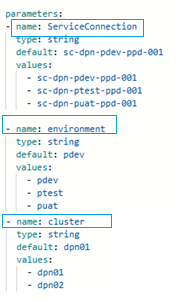

# DPN Monitoring Service Installation Process

---

## Table of Contents

- [Overview](#overview)
- [Prerequisites](#prerequisites)
- [Installation Steps](#installation-steps)
  - [Step1: Build the DPN Portal (Unified UI) Image](#step1-build-the-dpn-portal-unified-ui-image)
  - [Step2: Run `monitoring-master-cd.yaml`](#step2-run-monitoring-master-cdyaml)
    - [Step2a: Prepare runtime parameters](#step2a-prepare-runtime-parameters)
    - [Step2b: Execute CD Pipeline](#step2b-execute-cd-pipeline)
    - [Step2c: Approve Stage's Deployment Gate](#step2c-approve-stages-deployment-gate)
  - [Step3: Post Deployment Verification](#step3-post-deployment-verification)
- [Step4: Troubleshooting](#step4-troubleshooting)
  - [Config File Not Found for Specific Environment](#config-file-not-found-for-specific-environment)
  - [Deployed Resources Show the Wrong Environment Label](#deployed-resources-show-the-wrong-environment-label)
  - [Kafka/Zookeeper Image Pull Fails](#kafkazookeeper-image-pull-fails)
  - [OAuth2 Proxy Gateway Fails to Get a LoadBalancer Address (IP/Port Already Claimed)](#oauth2-proxy-gateway-fails-to-get-a-loadbalancer-address-ipport-already-claimed)
- [Step5: Containerized Deployment Using DSI Provided Container Images](#step5-containerized-deployment-using-dsi-provided-container-images)
  - [Step5a. Configure GHCR Image Access](#step5a-configure-ghcr-image-access)
  - [Step5b. Execute CD Pipeline](#step5b-execute-cd-pipeline)
  - [Step5c. Verify CD Pipeline](#step5c-verify-cd-pipeline)
- [Review Notes](#review-notes)

---

## Overview

This describes installation of the DPN Health Monitoring Service. The DPN Portal (Unified UI) image is built and published first, via the standalone `dpn-portal-ci.yaml` pipeline, since it is the one component in this repository built from source rather than pulled from an existing registry. `monitoring-master-cd.yaml` then orchestrates every other component through a multi-stage pipeline (Init → Approval → Validate Required Secrets → Kafka → OpenSearch → Prometheus → Thanos → Data Prepper → Jaeger → Perses → OTel → dpn-portal image → OAuth2 Proxy → Validate), deploying everything into `ns-dpn-health-01`. The pipeline is driven by `environment` and `cluster` runtime parameters and supports all provided environments — `dev`, `devtest`, `test` (each with `dpn01` or `dpn02`) and `pdev`, `ptest`, `puat` (single-cluster, `dpn01` only). The deployment approval gate resolves to the environment's approver group automatically (`dsi-dev`, `dsi-devtest`, or `dsi-ppd`).

For the configuration this installation depends on — the environment config file and the required secrets — see [Configure DPN Health Monitoring Service](../02-configuration/03-configure-dpn-health-monitoring-service.md).

## Prerequisites

- An AKS cluster matching the target environment's config, with `ns-dpn-health-01` already created.
- The Azure DevOps Service Connection for the target environment.
- Access to the environment-specific ACR for Kafka/Zookeeper/dpn-portal images, and to Docker Hub/Quay.io for everything else.
- `dpn-tls-cd` (from `dpn-federator-certificate-manager`) already run against this environment, so that `tls-auth-secret` exists in `ns-dpn-health-01` — the pipeline's Validate Required Secrets stage checks for it directly and fails fast if it is missing.
- The approval Environment resource for the target environment configured with its approval check — the pipeline resolves the group per environment (`dsi-dev`, `dsi-devtest`, or `dsi-ppd`).
- The per-environment config file (`config/<env>-<cluster>.json`, including `OBSERVABILITY_LB_IP`) prepared as described in [Configure DPN Health Monitoring Service → Step 1](../02-configuration/03-configure-dpn-health-monitoring-service.md#step-1-prepare-environment-configuration-file).
- The required secrets created as described in [Configure DPN Health Monitoring Service → Step 2](../02-configuration/03-configure-dpn-health-monitoring-service.md#step-2-prepare-secrets-configuration): `dpn-mon-storage-connection-string` (Thanos object-storage config, including the storage account/SAS token), the `dpn-health-tls` secret (created by `dpn-tls-cd`, see the prerequisite above), and in the environment's Key Vault — `KC-SERVICE-CLIENT-SECRET`, `KC-OPENSEARCH-ADMIN-PASSWORD`, `KC-OPENSEARCH-KIBANASERVER-PASSWORD`, and `KC-OPENSEARCH-DATAWRITER-PASSWORD` (all four are checked directly by the pipeline's Validate Required Secrets stage, which fails a fresh environment without them).
- SMTP relay details and an alert recipient address.
- The metrics-server running in the cluster (standard on AKS) — required for the OTEL Collector's HPA.

---

## Installation Steps

### Step1: Build the DPN Portal (Unified UI) Image

Run the `dpn-portal-ci.yaml` pipeline before running `monitoring-master-cd.yaml` for the first time in an environment, or whenever a new DPN Portal build is required.

```text
Root-Repository/
└── .pipelines/
    └── azure-pipelines/
        └── ci-pipelines/
            └── dpn-portal-ci.yaml
```

Select the target `serviceConnection`, `environment`, and `dpncluster` runtime parameters to match the deployment. The pipeline runs Checkmarx and FOSSA scans, unit tests with a code-coverage gate, a SonarQube analysis, then builds and pushes the image to the environment's container registry, signs it with Cosign, and scans it with JFrog X-Ray. Its final step prints the image tag to use — the short git SHA of the commit it built:

```text
Image pushed: <registry>/dpn-portal:<short-sha>
To deploy, queue dpn-portal-image-cd.yaml with:
  imageTag = <short-sha>
```

Record this tag — it is required as the `dpnPortalImageTag` runtime parameter in Step2a below.

---

### Step2: Run `monitoring-master-cd.yaml`

#### Step2a: Prepare runtime parameters

The CD Pipeline provided needs to be modified in the following places to point to the Organisation's service connection and environment.

| Parameter | Value |
|-----------|-------|
| `ServiceConnection` | `A given Service Connection able to deploy the services` |
| `environment` | `environment abbreviation` — `dev`, `devtest`, `test`, `pdev`, `ptest`, or `puat` |
| `cluster` | `dpn01` or `dpn02` (DSI provides two dpn configurations per environment for `dev`/`devtest`/`test`; `pdev`/`ptest`/`puat` are single-cluster and only accept `dpn01`) |
| `imageTag` | Image tag for the OTel Collector (default `0.95.0`) |
| `dpnPortalImageTag` | Image tag for the dpn-portal image — **no default; must be supplied** (the short git SHA from a `dpn-portal-ci.yaml` run) |



**Note:** Organisations must review the CD Pipeline code for the following. 

- The agent pool name has been modified to Organisation required agent pool name
- There should not be any `<<Your specific value>>` in the parameters. The DSI package has provided this specific paramter to ensure configuration is modified by Organisations
- The container images are appropriate and referred from the Organisation's chosen registry — Kafka, Zookeeper, and the dpn-portal image built in Step1 are pulled from the environment's ACR; OpenSearch, Jaeger, Perses, Thanos, Data Prepper, the OTel Collector, and oauth2-proxy are pulled from Docker Hub/Quay.io
- The environment parameters are pointing to correct deployment environment
- The DSM endpoints are correctly pointing to the target deployment environment
- Required Firewall rules are applied

#### Step2b: Execute CD Pipeline

Create and run CD Pipeline for monitoring service from the following CD pipeline yaml file

```text
Root-Repository/
└── .pipelines/
    └── azure-pipelines/
        └── cd-pipelines/
            └── monitoring-master-cd.yaml
```
---

#### Step2c: Approve Stage's Deployment Gate

Organisations should maintain an approval gate for the deployment. The CD Pipeline prompts for approval under the target environment's approver group, which it resolves automatically — `dsi-dev` for `dev`, `dsi-devtest` for `devtest`/`test`, and `dsi-ppd` for `pdev`/`ptest`/`puat`. The corresponding Azure DevOps Environment needs to be created by the Organisation to allow only authorised personnel to perform deployment.

---

### Step3: Post Deployment Verification

1. Confirm all pods `Running`.
2. Confirm the init pods completed the job (e.g. the OpenSearch dashboard init job).
3. Confirm resource labels reflect the correct environment name.
4. Confirm the four `oauth2-proxy` gateways (OpenSearch Dashboards, Jaeger, Perses, Portal) each have a ready replica and a LoadBalancer address — the pipeline's Validate stage asserts this and fails the run if any is not serving.

---

## Step4: Troubleshooting

Every troubleshooting entry (Kafka naming-regression checks in `kafka-cd.yaml`, the OTel→Kafka dependency check, CrashLoop from a missing `health_check` extension, HPA `<unknown>` targets) applies unchanged, since it's chart-level logic. Additional entries specific to this reconciliation:

### Config File Not Found for Specific Environment

Confirm `<env>-<cluster>.json` exists under `.pipelines/azure-pipelines/config/` with this exact naming (e.g. `pdev-dpn01.json`) — prepared per [Configure DPN Health Monitoring Service → Step 1](../02-configuration/03-configure-dpn-health-monitoring-service.md#step-1-prepare-environment-configuration-file).

### Deployed Resources Show the Wrong Environment Label

Confirm Step2a used the **corrected** `ENV_NAME` values

### Kafka/Zookeeper Image Pull Fails

Confirm `BASE_REGISTRY` in the config file hosted under .pipelines root folder must uses a fully-resolved hostname like `acrdpnXXXX.azurecr.io`,, not a literal like only `acrdpnXXXX` placeholder 

### OAuth2 Proxy Gateway Fails to Get a LoadBalancer Address (IP/Port Already Claimed)

**Scenario:** the `OAuth2Proxy` stage's last job (the gateway sharing a port with another internal service — see below) fails, typically during `helm upgrade --wait`, with the Service stuck with no LoadBalancer address, or Azure rejecting the request outright.

**Why this happens:** every `oauth2-proxy` release in `ns-dpn-health-01` shares one fixed internal `loadBalancerIP` (from `OBSERVABILITY_LB_IP`), differing only by port — that's why the jobs are chained rather than parallel (see the comment in `oauth2-proxy-cd.yaml`). That address is only "reserved" by convention, in this pipeline's own config — nothing reserves it at the Azure/subnet level ahead of time. Any other Service in the same subnet that is deployed independently — by a different pipeline, a different repository, possibly into a different namespace, with no `dependsOn` relationship to this one at all — can claim that same address if its own `loadBalancerIP` has not yet been pinned to something else. Left empty (the common "auto-assign on first deploy, then pin whatever Azure gave it" pattern), Azure is free to hand that Service *any* available address in the subnet on its first deploy, including the exact one `OBSERVABILITY_LB_IP` expects to reserve. Whichever Service asks first wins it — this is not specific to any one component; it can be Keycloak, or equally any other independently-deployed internal LoadBalancer Service sharing the subnet. If that Service's port also happens to match one of the oauth2-proxy gateways' ports, that gateway's job then fails to claim the address it expected.

**Fix (unblock the failed deploy):**

1. Identify which other Service actually holds `OBSERVABILITY_LB_IP` right now (e.g. `kubectl get svc -A -o json | jq` filtering on `.status.loadBalancer.ingress[].ip`, across every namespace in the cluster, not just this one).
2. Do **not** move `OBSERVABILITY_LB_IP` itself — the other oauth2-proxy gateways sharing it on different ports are typically already deployed and working, and moving it would break all of them instead of just the one that failed.
3. Instead, relocate the other Service off the address it accidentally took:
   - Identify a genuinely free static IP in the subnet (check with whoever manages that VNet/subnet).
   - Pin it explicitly in that Service's own chart values (its `loadBalancerIP` field, wherever that chart exposes it) — do not leave it empty.
   - Redeploy that component so its Service picks up the newly pinned address. Expect a brief outage for it during the LoadBalancer cutover.
   - If any manual/external DNS record points at that Service's old address, update it to the new one.
4. Re-run the failed `OAuth2Proxy` stage (or just the one failed job) — the earlier gateway releases are idempotent and unaffected.

**Prevention:**

- Never leave `loadBalancerIP` empty on any internal LoadBalancer Service beyond its very first deploy in a new environment, regardless of which component it belongs to or which pipeline deploys it. The "deploy once with it empty, then pin whatever Azure assigned" convention is exactly what allows one component to silently take an address reserved by convention for another. Pin every fixed-IP Service explicitly before any other component that might race it into existence.
- Treat `OBSERVABILITY_LB_IP` (and any other fixed internal IP convention) as reserved across the *entire* environment and every namespace in it, not just within the namespace one pipeline deploys into — a collision can come from any independently-deployed component, in any other namespace, deployed by any other pipeline.
- Where practical, extend a deploy pipeline's own pre-flight port-conflict check to look across all namespaces in the cluster, not only the one it is deploying into — a check scoped to a single namespace cannot catch a cross-namespace collision like this one, regardless of which other component ends up on the other side of it.

---

## Step5: Containerized Deployment Using DSI Provided Container Images

This section covers deployment of the DPN Portal (Unified UI) using the **DSI-published container image** at `ghcr.io/energy-dsi`, for organisations that prefer to pull the pre-built image directly rather than running the `dpn-portal-ci.yaml` CI pipeline in Step1.

| Image Name | GHCR Path | Tag |
|---|---|---|
| dpn-portal-ui | `ghcr.io/energy-dsi/dpn-portal` | `1.0.0` |

### Step5a. Configure GHCR Image Access

All custom and third-party images are pulled from `ghcr.io/energy-dsi`.

Even though the `energy-dsi` GHCR packages are **public**, GitHub Container Registry still requires authentication (a GitHub username and Personal Access Token) to pull images reliably. Unauthenticated pulls are subject to strict rate limits and may fail in automated environments.

Create a GitHub Personal Access Token with `read:packages` scope. Once the token is available, create a kubernetes secret from the same. This secret will be used during the image pull.

```bash
kubectl create secret docker-registry ghcr-pull-secret \
     --docker-server=ghcr.io \
     --docker-username=<github-username-or-bot-account> \
     --docker-password=<GitHub PAT with read:packages scope> \
     -n ns-dpn-health-01
```

### Step5b. Execute CD Pipeline

Run `dpn-portal-image-cd.yaml` to deploy the chart with the GHCR image, instead of the environment's ACR image built in Step1.

```text
Root-Repository/
└── .pipelines/
    └── azure-pipelines/
        └── cd-pipelines/
            └── dpn-portal-image-cd.yaml
```

The pipeline builds its image repository from `CONTAINER_REGISTRY_URL` in the environment's config file (`config/<env>-<cluster>.json`). Point this at `ghcr.io/energy-dsi` for the target environment before running the pipeline, so the deployed `image.repository` resolves to `ghcr.io/energy-dsi/dpn-portal` rather than the environment's ACR.

The CD Pipeline would require the following run time parameters.

| Parameter | Value |
|-----------|-------|
| `ServiceConnection` | `A given Service Connection able to deploy the services` |
| `environment` | `environment abbreviation` |
| `cluster` | `dpn01` (DSI provides two dpn configurations per environment. Organisations may keep only one such as dpn01 to run a single DPN cluser)` |
| `imageTag` | Provides the release version or image tag to be pulled from GHCR — `1.0.0` |

Execute this CD Pipeline to perform deployment.

---

### Step5c. Verify CD Pipeline

Follow the same verification steps mentioned in Step3 above.

---

## Review Notes

| Review Date | Last Reviewed By | Status | Semver Version (Major.Minor.Patch) |
|-------------|------------------|--------|----------|
| May-2026 | DSI Assurance   | Final  | V1.0.0 | 
| Sep-2026 | DSI Assurance   | Final  | V2.0.0 | 
| Oct-2026 | DSI Assurance   | Final  | V2.1.0 | 

