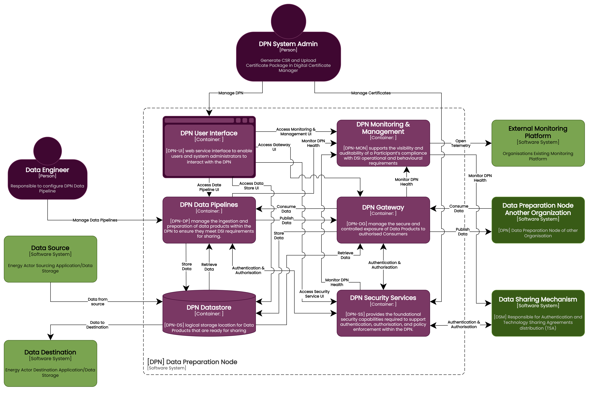

Release : 2.1.0 - Oct 2026

# DPN Deployment Configuration Guide

---

## Table of Contents

- [Overview](#overview)
  - [Continuous Integration (CI)](#continuous-integration-ci)
  - [Continuous Deployment (CD)](#continuous-deployment-cd)
- [Global and Generic Configuration](#global-and-generic-configuration)
  - [Step1: DSI DSM Endpoint Configuration](#step1-dsi-dsm-endpoint-configuration)
  - [Step2: GitHub Actions Configuration](#step2-github-actions-configuration)
    - [Step2.1: Self-Hosted Runner Set Up](#step21-self-hosted-runner-set-up)
    - [Step2.2: Azure Environment Configuration](#step22-azure-environment-configuration)
    - [Step2.2.1: GitHub Actions Secrets and Environments](#step221-github-actions-secrets-and-environments)
    - [Step2.3: AKS Namespace Configuration](#step23-aks-namespace-configuration)
  - [Step3: Secrets Configuration](#step3-secrets-configuration)
  - [Step4: Certificate Configuration](#step4-certificate-configuration)
  - [Step5: Network and Ports Configuration](#step5-network-and-ports-configuration)
  - [Step6: DPN Internal Domain Naming (DNS) Configuration](#step6-dpn-internal-domain-naming-dns-configuration)
  - [Step7: DPN Secrets Reference](#step7-dpn-secrets-reference)
    - [DPN shared secrets](#dpn-shared-secrets)
    - [Copy shared secrets into ns-dpn-dp-01 (Data Pipelines prerequisite)](#copy-shared-secrets-into-ns-dpn-dp-01-data-pipelines-prerequisite)
- [Review Notes](#review-notes)

---

## Overview

Data Preparation Node (DPN) consists of the following components in the DSI package:



- **DPN User Interface** - A unified user interface experience for DPN with embedded links for individual DPN component User interfaces for example, Opensearch dashboard, Apache Perses, Jaeger, DPN Vault service, User and Role management, Kafka UI and Federator Job runner
- **DPN Health Monitoring Service** - Provides health monitoring view of DPN components, metric, traces and logs collector with Open Telemetry data format, Kafka for log consolidation, Opensearch, Jaeger and Apache Perses for logs, Traces and metrics view of individual DPN components in health dashboard
- **DPN Data Pipelines** — Responsible for producing and consuming data products of an organisation.Scheduler to control DPN data pipeline manual and automatic scheduling
- **DPN Gateway Service** — Responsible for DSM and DPN authentication, and data transfer between DPN nodes, either via the streamed gRPC Federator or the synchronous REST Federator Gateway.
- **DPN Data Store Service**
  - Storage — Contains storage accounts or S3 buckets to store files produced by DPN data pipelines, certificate material, and Redis caching data.
  - Streaming Service — DPN uses Kafka as a streaming service for managing events and topics during data transmission, authenticated via Keycloak (`SASL_SSL`/`OAUTHBEARER`) by default.
- **DPN Security Service**
  - Vault Service — Certificate regeneration for DSM communication and storage, and the store the Certificate Manager and Federator Gateway build their mTLS keystore/truststore from in memory (no shared file share).
  - Digital Certificate Manager — Manages recycling of certificates at a predefined interval from the DSI Management Node.
  - DPN Authentication Service — Keycloak-based OAuth2/OIDC Identity Provider used for Kafka broker authentication and Keycloak SSO on the DPN observability UIs.
  - DPN File Scan Service - Cloud native file scan service for files arriving on Federator Gateway, using Defender for Cloud Storage on Azure or GuardDuty Malware Protection for S3 on AWS

DPN components on an Azure environment are deployed using the **GitHub Actions pipeline**, running on a self-hosted runner pool. 

This document describes the configuration parameters required for deploying **DPN nodes on Azure Kubernetes Service (AKS)**. These parameters must be configured before running the deployment pipelines.

The configuration covers the following areas:

- DSI DSM endpoint configuration
- GitHub Actions configuration
- Secret configuration
- Helm chart configuration
- Network and ports configuration

---

### Continuous Integration (CI)

The **Continuous Integration (CI)** is not part of this GitHub Actions based deployment. Participants may refer the `azure-ado-beta` for referring to CI pipelines. Azure deployment is considered using the Containised Deployment strategy from the images placed in [GHCR](https://github.com/orgs/energy-dsi/packages) and deployment on the AKS platform 

---

### Continuous Deployment (CD)

The **Continuous Deployment (CD)** pipeline deploys the container images to the **Azure AKS** cluster using Helm. 

During deployment, the pipeline performs the following steps:

1. Read the environment/cluster config JSON (`.github/config/azure/<environment>-<cluster>.json` in the component's own repository) into the job.
2. Authenticate to Azure via the component repository's `cloud-login` composite action (`.github/actions/cloud-login/action.yml`) using **Azure Workload Identity / OIDC federation** — the runner requests an OIDC token, exchanges it via `az login --service-principal --username $AZURE_CLIENT_ID --tenant $AZURE_TENANT_ID --federated-token $OIDC_TOKEN`, then sets the target subscription (`az account set --subscription $ARM_SUBSCRIPTION_ID`), no long-lived access key involved. See [Azure Workload Identity / Federated Identity Credential](../01-prerequisites/01-dpn-prerequisites.md#azure-workload-identity--federated-identity-credential).
3. Retrieve credentials for the target AKS cluster (`az aks get-credentials --resource-group $RESOURCE_GROUP --name $AKS_CLUSTER --overwrite-existing`, followed by `kubelogin convert-kubeconfig -l azurecli`).
4. Validate Helm charts using `helm lint` and a Helm **dry-run**.
5. Deploy the DPN component using `helm upgrade --install`.
6. Verify deployment status using Kubernetes rollout checks, and publish the deployed image digest as a workflow artifact.

---
## Global and Generic Configuration

### Step1: DSI DSM Endpoint Configuration

DSI provides predefined endpoints to support the following environments:

- Development
- Integration Testing
- Pre-Production

These endpoints are publicly accessible to simplify integration and testing. Organisations must configure their pipelines to use the **appropriate endpoint for the corresponding deployment environment** as provided by DSI.

| Environment | Component | URL |
|-------------|-----------|-----|
| Pre Production-Dev (pdev) | Authentication | https://auth-mtls.dsm01.dsipreprod1.neso.energy |
| Pre Production-Dev (pdev)| Management Node | https://management.dsm01.dsipreprod1.neso.energy |
| Pre Production-Dev (pdev)| DSI DPN GRPC Producer | https://producer.dpn01.dsipreprod1.neso.energy |
| Pre Production-Dev (pdev)| DSI DPN REST Producer | https://producer-rest01.dpn01.dsipreprod1.neso.energy |
| Pre Production-test (ptest) | Authentication | https://auth-mtls.dsm01.dsipreprod2.neso.energy |
| Pre Production-test (ptest)| Management Node | https://management.dsm01.dsipreprod2.neso.energy |
| Pre Production-test (ptest)| DSI DPN GRPC Producer | https://producer.dpn01.dsipreprod2.neso.energy |
| Pre Production-test (ptest)| DSI DPN REST Producer | https://producer-rest01.dpn01.dsipreprod2.neso.energy |
| Pre Production-uat (puat) | Authentication | https://auth-mtls.dsm01.dsipreprod3.neso.energy |
| Pre Production-uat (puat)| Management Node | https://management.dsm01.dsipreprod3.neso.energy |
| Pre Production-uat (puat)| DSI DPN GRPC Producer | https://producer.dpn01.dsipreprod3.neso.energy |
| Pre Production-uat (puat)| DSI DPN REST Producer | https://producer-rest01.dpn01.dsipreprod3.neso.energy |

---

### Step2: GitHub Actions Configuration

The provided pipelines require the following configuration to perform **CI and CD operations**.

#### Step2.1: Self-Hosted Runner Set Up

Every CD workflow runs on a self-hosted GitHub Actions runner pool as DPN environment is private and no access from outside internet. This runner set up is participant responsibility

```yaml
runs-on: [self-hosted, vmss]
```

---

#### Step2.2: Azure Environment Configuration

Every CD workflow reads its Azure targeting from a single, consistently-named JSON config file in respective DPN repositories published in GitHub. **Update this file with your environment's values before running any pipeline** for that environment/cluster.

```text
<component-repo>/
└── .github/
    └── config/
        └── azure/
            └── <environment>-<cluster>.json     # e.g. dev-dpn01.json
```

Every DPN component repository carries the same set of keys in this file, so set the same values in each repository you deploy from.

| Key | Description | Example (placeholder) |
|-----|-------------|-----------------------|
| AZURE_SUBSCRIPTION_ID / ARM_SUBSCRIPTION_ID | Azure subscription ID hosting the infrastructure (`ARM_SUBSCRIPTION_ID` is the one `cloud-login` selects with `az account set`) | `<subscription-id>` |
| RESOURCE_GROUP | Resource group hosting the cluster | `rg-aks-dpn-azure-<env>-uks-<nn>` |
| AKS_CLUSTER | Name of the AKS cluster | `aks-dpn-azure-<env>-uks-<nn>` |
| KEY_VAULT_NAME | Azure Key Vault the workflows read and write DPN secrets in | `kv-dpn-azure-<env>-uks-<nn>` |
| NAMESPACE | Kubernetes namespace for the deployment | `ns-dpn-01` |
| BASE_REGISTRY / ACR_NAME | Base container registry URL — GHCR is used on both clouds, not Azure Container Registry | `ghcr.io` |
| FILESCAN_STORAGE_ACCOUNT | Storage account Defender for Storage malware scanning is enabled on (File Scan Service) | `<storage-account-name>` |
| FILESCAN_STORAGE_RG | Resource group of that storage account (File Scan Service) | `<storage-resource-group>` |
| FILESCAN_SB_SUBSCRIPTION_NAME | Service Bus topic subscription for scan results (File Scan Service) | `<servicebus-subscription-name>` |
| FILESCAN_DEFENDER_EVENT_SUBSCRIPTION_NAME | Event Grid event subscription that forwards Defender scan results to Service Bus (File Scan Service) | `<event-subscription-name>` |
| OAUTH2_PROXY_EXTERNAL_URL | *(optional)* External URL of the Self-Service Data Pipelines UI, used by `dpn-gha-self-service-cd.yaml` | `https://dpn-self-service-external.ns-dpn-dp-01.svc.cluster.local` |

> **Note:** `environment` (`dev`/`test`), `cluster` (`dpn01`/`dpn02`), and `cloud` (`azure`) are supplied as `workflow_dispatch` **inputs** when you trigger a run in the Actions tab — they are **not** keys in the JSON file. Most CD workflows default `cloud` to `aws`, so select `azure` explicitly. The Helm **values file** is derived from those inputs: `<component>/charts/<chart>/values/azure/<environment>-<cluster>.yaml`. The `FILESCAN_*` keys are read only by `dpn-gha-file-scan-prerequisites-cd.yaml` (dpn-file-scan-service).

#### Step2.2.1: GitHub Actions Secrets and Environments

Every CD workflow runs in a **GitHub Environment** named `<environment>-<cluster>` (`environment: ${{ inputs.environment }}-${{ inputs.cluster }}`), e.g. `dev-dpn01`. Configure the following Actions secrets (repository or environment level) in the component repository whose workflow uses them:

| GitHub Actions Secret | Used by | Purpose |
|-----------------------|---------|---------|
| `AZURE_CLIENT_ID`, `AZURE_TENANT_ID` | Every CD workflow (passed to `cloud-login`) | Client ID and tenant ID of the federated identity — see [Azure Workload Identity / Federated Identity Credential](../01-prerequisites/01-dpn-prerequisites.md#azure-workload-identity--federated-identity-credential) |
| `DPN_TLS_KEYSTORE_PASSWORD` | `dpn-gha-tls-cd.yaml` (dpn-federator-certificate-manager) | `keystore.jks` password |
| `DPN_TLS_TRUSTSTORE_PASSWORD` | `dpn-gha-tls-cd.yaml`, `dpn-gha-vault-tls-bootstrap-cd.yaml` (dpn-federator-certificate-manager), `dpn-gha-demo-runner-cd.yaml` (dpn-rest-federator-gateway) | `truststore.jks` password |
| `DPN_TLS_CLIENT_P12_PASSWORD` | `dpn-gha-tls-cd.yaml` (dpn-federator-certificate-manager) | `dsm-client.p12` password |
| `VAULT_KEY`, `CERTIFICATE_PEM`, `CA_CHAIN_PEM` | `dpn-gha-vault-load-bundle-cd.yaml` (dpn-federator-certificate-manager) | Contents of `vault.key`, the DSM-signed `certificate.pem` and the DSM `ca-chain.pem` |

---

#### Step2.3: AKS Namespace Configuration

Create the following Kubernetes namespaces in AKS, along with the shared storage class, ServiceAccount, and image-pull secret every component depends on. This setup needs to be done manually and one time in the Kubernetes cluster — no workflow provisions this cluster bootstrap step:

- ns-dpn-01
- ns-dpn-health-01
- ns-dpn-dp-01 — dedicated namespace for DPN Data Pipelines (Self-Service UI, producer and consumer releases)

```bash
kubectl create namespace <namespace>
```

> **Create `ns-dpn-dp-01` before running `dpn-gha-tls-cd.yaml`.** The Universal TLS workflow copies `dpn-tls` and `tls-auth-secret` into `ns-dpn-dp-01` only if that namespace already exists; if it does not, the workflow skips those copies without failing. If you create the namespace afterwards, re-run `dpn-gha-tls-cd.yaml` or copy the two secrets by hand (see [Copy shared secrets into ns-dpn-dp-01](#copy-shared-secrets-into-ns-dpn-dp-01-data-pipelines-prerequisite)).

A shared `federator-server` Kubernetes ServiceAccount is used by several components  pods to authenticate across components:

```bash
kubectl create serviceaccount federator-server -n ns-dpn-01
```

Create the GHCR image-pull secret used by every component (imperatively — do not store real credentials in a file). Requires a GitHub personal access token with `read:packages` scope:

```bash
kubectl create secret docker-registry ghcr-pull-secret \
  --docker-server=ghcr.io \
  --docker-username=<GH_USER> \
  --docker-password=<GH_PAT_read:packages> \
  -n ns-dpn-01

kubectl create secret docker-registry ghcr-pull-secret \
  --docker-server=ghcr.io \
  --docker-username=<GH_USER> \
  --docker-password=<GH_PAT_read:packages> \
  -n ns-dpn-health-01

kubectl create secret docker-registry ghcr-pull-secret \
  --docker-server=ghcr.io \
  --docker-username=<GH_USER> \
  --docker-password=<GH_PAT_read:packages> \
  -n ns-dpn-dp-01
```

---

### Step3: Secrets Configuration

Sensitive credentials must **not be stored in source code repositories**. They must be stored securely in one of the following vaults:

- **HashiCorp Vault** — provided with the DSI DPN package as community edition
- **Azure Key Vault** — Azure native secrets store for credentials
- **Azure Workload Identity (Federated Identity Credentials)** — used where a component needs direct Azure API access (Storage Account, Service Bus, Key Vault) without a stored credential

Organisations **must change the default values of secrets** — i.e. sample values such as `changeit`, `admin-password`, `admin-admin`, etc.

Organisations should rotate secrets at defined frequencies.
The secrets are described in the individual component sections of this document that follow.

---

### Step4: Certificate Configuration

During the organisation's onboarding process, an initial certificate package containing the certificate and CA chain files is provided during the bootstrap process from the DSM User Interface. Organisations must securely store these certificates in the vault service. The following certificate artefacts are included in the DPN package:

- The **P12/PFX certificate** issued by the DSI DSM Certificate Authority (keystore)
- The **DSI certificate chain pem file** (truststore)

Refer to the [DPN Federator Certificate Manager](04-configure-dpn-certificate-manager.md) section for detailed instructions on certificate lifecycle management.

The same certificate files are used across all DPN components that require integration with the Data Sharing Mechanism (DSM), specifically the GRPC/REST Federator Gateway and Certificate Lifecycle Manager.

---

### Step5: Network and Ports Configuration

This section describes DPN connectivity requirements for ports and protocols.


The following firewall rules must be applied by the organisation before installing DPN:

| Source IP Address | Source VNet | Source Subnet | Destination IP / Zone / URL | Destination VNet | Destination Subnet | Protocol | Port(s) | Traffic Flow |
|-------------------|-------------|---------------|-----------------------------|------------------|--------------------|----------|---------|--------------|
| AKS worker node IP range | DPN Kubernetes VNet | Node subnet | `packages.confluent.io/*` | N/A | N/A | TLS | 443 | Outbound |
| AKS worker node IP range | DPN Kubernetes VNet | Node subnet | `registry-1.docker.io/*`<br>`auth.docker.io/*`<br>`production.cloudflare.docker.com`<br>`index.docker.io/*` | N/A | N/A | TLS | 443 | Outbound |
| DPN Kubernetes subnet IP range | DPN Kubernetes VNet | DPN Kubernetes subnet | `auth-mtls.dsm01.dsi(xxx).neso.energy` | N/A | N/A | TLS | 443 | Outbound |
| DPN Kubernetes subnet IP range | DPN Kubernetes VNet | DPN Kubernetes subnet | `management.dsm01.dsi(xxx).neso.energy` | N/A | N/A | TLS | 443 | Outbound |
| DPN Kubernetes subnet IP range | DPN Kubernetes VNet | DPN Kubernetes subnet | Organisation-specific URL for DPN-to-DPN data sharing | N/A | N/A | TLS | 443 | Bi-directional |

> **Note:** The organisation-specific URL in the final row defines the target organisation with which data sharing will occur. These firewall rules must be opened from both organisations' network perspectives. The `dsi(xxx)` notation refers to the `dev` and `test` environments.

> DPN GRPC Federator Gateway uses HTTP/2 traffic over gRPC on port **443**. HTTP/2 traffic requires TCP passthrough to a Layer 4 network load balancer (an Azure Standard Load Balancer); Layer 7 load balancing may not be supported for this traffic for most layer 7 load balancers.

---

### Step6: DPN Internal Domain Naming (DNS) Configuration

Release 2.1.0 introduces a consistent internal domain naming strategy for every DPN user interface, based on **Kubernetes Service DNS** rather than per-UI ingress hostnames or IP addresses. Every browser-facing UI link is configured, from a single place, on the **DPN Unified User Interface (DPN Portal)** service — the `dpn-portal` Helm chart's `tiles[].components[].url` values — which is the source of truth for the table below.

Names follow the standard Kubernetes internal DNS pattern:

```
<service-name>.<namespace>.svc.cluster.local
```

The two AKS namespaces that host DPN UIs are `ns-dpn-01` and `ns-dpn-health-01`. The `dpn-common` TLS certificate used across these UIs is issued with exactly two SANs, `*.ns-dpn-01.svc.cluster.local` and `*.ns-dpn-health-01.svc.cluster.local`, which is why every UI is reached through one of those two domains rather than an IP address or an arbitrary hostname — a wildcard SAN can only match a DNS name, never an `iPAddress` SAN, so browsing by IP always fails certificate validation.

#### DPN component UI DNS reference (configured via the DPN Portal / Unified UI service)

The following internal URLs will be default for accessing the DPN User interfaces. Participants must install the dpn-root certificate generated during the Vault set up process in the respective systems from where DPN portal is accessed. Refer section 3A in [DPN Vault Service](01-configure-dpn-vault-service.md)

These URLs operate on Kuberenetes DNS. To access these URLs, a local host entry needs to be made in the system/Windows VM. The host file is generally present in `C:\Windows\System32\drivers\etc\hosts` location. Open the file in a notepad with admin credential and put the below entries against their load balancer IP. 

```
10.XXX.XXX.XXX dpn-kafka-ui-external.ns-dpn-01.svc.cluster.local
10.XXX.XXX.XXX dpn-keycloak-service-lb.ns-dpn-01.svc.cluster.local
10.XXX.XXX.XXX dpn-federator-client-1-external.ns-dpn-01.svc.cluster.local
10.XXX.XXX.XXX dpn-observability.ns-dpn-health-01.svc.cluster.local
10.XXX.XXX.XXX dpn-vault-https-lb.ns-dpn-01.svc.cluster.local

```


| DPN Portal Tile | Component | DNS Name | Port | Namespace | Access |
|------------------|-----------|----------|------|-----------|--------|
| Users & Roles | Keycloak Console | `dpn-keycloak-service-lb.ns-dpn-01.svc.cluster.local` | 8443 | ns-dpn-01 | `dpnadmin` only |
| Data / Store | DPN Kafka (Kafka UI) | `dpn-kafka-ui-external.ns-dpn-01.svc.cluster.local` | 8086 | ns-dpn-01 | `dpnadmin`, `dpnreader` — native Keycloak OIDC |
| Gateway | GRPC Gateway Client (Federator Client / Job Runner) | `dpn-federator-client-1-external.ns-dpn-01.svc.cluster.local` | 8085 | ns-dpn-01 | `dpnadmin`, `dpnreader` — plain HTTP (see [Federator Gateway release notes](../../../06-release-notes/release-2.0.0-configuration-changes.md#dpn-federator-gateway)) |
| Security / Services | Certification Vault Service | `dpn-vault-https-lb.ns-dpn-01.svc.cluster.local` | 8200 | ns-dpn-01 | `dpnadmin`, `dpnreader` |
| Health / Monitoring Service | Log Stack (OpenSearch Dashboards) | `dpn-observability.ns-dpn-health-01.svc.cluster.local` | 5601 | ns-dpn-health-01 | `dpnadmin`, `dpnreader` — via `dpn-oauth2-proxy-osd` Keycloak SSO |
| Health / Monitoring Service | Traces Stack (Jaeger) | `dpn-observability.ns-dpn-health-01.svc.cluster.local` | 16686 | ns-dpn-health-01 | `dpnadmin`, `dpnreader` — via `dpn-oauth2-proxy-jaeger` Keycloak SSO |
| Health / Monitoring Service | Metrics Dashboard (Apache Perses) | `dpn-observability.ns-dpn-health-01.svc.cluster.local` | 8083 | ns-dpn-health-01 | `dpnadmin`, `dpnreader` — via `dpn-oauth2-proxy-perses` Keycloak SSO |
| Health / Monitoring Service | Collector Stack (Kafka Health UI) | `dpn-observability.ns-dpn-health-01.svc.cluster.local` | 8082 | ns-dpn-health-01 | `dpnadmin`, `dpnreader` |
| — (the Portal itself) | DPN Portal (Unified UI landing page) | `dpn-observability.ns-dpn-health-01.svc.cluster.local` | 8443 | ns-dpn-health-01 | All authenticated users — via `dpn-oauth2-proxy-portal` Keycloak SSO |

`dpn-observability` is a single static internal Load Balancer address in `ns-dpn-health-01` shared by all four Keycloak-fronted UIs above (OpenSearch, Jaeger, Perses, and the Portal itself) — each one takes the port its UI already used, so only the scheme changes (`http` → `https`) and the login changes from basic auth to Keycloak SSO.

#### Using your own DNS instead of the `*.svc.cluster.local` names

Organisations that prefer their own corporate hostnames instead of the Kubernetes-style `*.svc.cluster.local` names above can do so, but this is **not** a DNS-only change — the TLS certificate and every Keycloak client registration are bound to the current names:

1. **Reissue or extend the `dpn-common` TLS certificate** used by the DPN Portal / oauth2-proxy releases so its SAN list covers your chosen hostnames (in addition to, or instead of, the two `*.svc.cluster.local` wildcards). TLS validation matches on the `DNS:` SAN entries only — an IP or an unlisted hostname will fail with `ERR_CERT_COMMON_NAME_INVALID` regardless of whether the CA itself is trusted.
2. **Update `externalUrl` in every affected Helm values file** — the four `oauth2-proxy` releases (`values-portal.yaml`, `values-opensearch.yaml`, `values-jaeger.yaml`, `values-perses.yaml`), the `dpn-portal` chart's own `externalUrl` and `tiles[].components[].url` entries, and `keycloak.publicUrl` — to your new hostnames.
3. **Re-register the new hostnames as Keycloak redirect URIs and Web Origins** on the shared `dpn-service-client` client in the `dpn-realm` realm. Keycloak matches redirect URIs and origins **exactly**; a login attempt against a hostname that isn't registered fails with `invalid_redirect_uri`.
4. **Point your own DNS zone at the same static internal Load Balancer IPs** already provisioned for `dpn-observability` and `dpn-keycloak-service-lb` (or provision your own if you also change the Load Balancer configuration).
5. **Re-run the CD pipelines** for the DPN Portal / Observability UIs and Keycloak (Authentication Service) so the updated values, certificate, and realm configuration are applied together — a partial update (e.g. new DNS record but unregistered redirect URI) will break login for that UI.

---

### Step7: DPN Secrets Reference

This section consolidates secret used across the DPN platform.

#### DPN shared secrets

The following secrets are shared by DPN components to use encryption in transit between component to component communication and also for DPN to DSM mTLS communication for selective components.

| Kubernetes Secret | Key(s) | Backing Azure Key Vault Path | Purpose | Namespace(s) | Consumed by |
|---|---|---|---|---|---|
| `certificate-manager-secrets` | `VAULT_TOKEN`, or `VAULT_APPROLE_SECRET_ID` when `vault.authentication: APPROLE` | `<KEY_VAULT_NAME>/VAULT-TOKEN` or `<KEY_VAULT_NAME>/VAULT-APPROLE-SECRET-ID` (synced by the `dpn-certificate-manager-kv-secrets` SecretProviderClass) | Vault credential for PKI bootstrap. The Vault truststore password is no longer synced here — it is read from `tls-auth-secret` (`TRUSTSTORE_PASSWORD`) | ns-dpn-01 | Certificate Manager, Federator Gateway, REST Federator Gateway |
| `dpn-keycloak-secrets` | `KC_SERVICE_CLIENT_SECRET`, `KEYCLOAK_ADMIN_PASSWORD`, `KC_DB_PASSWORD`, `KC_HTTPS_KEY_STORE_PASSWORD`, `KC_HTTPS_TRUST_STORE_PASSWORD` | `<KEY_VAULT_NAME>/keycloak-KC-SERVICE-CLIENT-SECRET` (set manually before first deploy — see note below), `.../KEYCLOAK-ADMIN-PASSWORD`, `.../KC-DB-PASSWORD`, `.../KC-HTTPS-KEY-STORE-PASSWORD`, `.../KC-HTTPS-TRUST-STORE-PASSWORD` | `dpn-service-client` OIDC client secret, Keycloak's own admin/database passwords, and its keystore/truststore passwords | ns-dpn-01, ns-dpn-dp-01 (manual copy — see [below](#copy-shared-secrets-into-ns-dpn-dp-01-data-pipelines-prerequisite)) | Authentication Service (Keycloak), Data Pipelines (Kafka OAUTHBEARER), Federator Gateway (Kafka OAUTHBEARER, Kafka UI, Federator Client/Server) |
| `kafka-secrets` | `UNIVERSAL_DPN_CERT_PASSWORD`, `KEYCLOAK_ADMIN_PASSWORD`, `KC_HTTPS_KEY_STORE_PASSWORD`, `KC_HTTPS_TRUST_STORE_PASSWORD`, `KAFKA_OAUTH_CLIENT_SECRET` | `<KEY_VAULT_NAME>/kafka-UNIVERSAL-DPN-CERT-PASSWORD`, plus its own copies of the Keycloak admin/keystore/truststore passwords and the Kafka OAuth client secret | Kafka broker keystore/truststore password and OAuth client credentials | ns-dpn-01 | Kafka brokers (Federator Gateway's `dpn-platform` chart) |
| `tls-auth-secret` | `KEYSTORE_PASSWORD`, `TRUSTSTORE_PASSWORD`, `DPN_CLIENT_P12_PASSWORD` | n/a — created directly via `kubectl create secret generic`, not sourced from Azure Key Vault | Shared passwords for keystore/truststore access and mTLS client cert; written by `dpn-gha-tls-cd.yaml` into the target namespace, `ns-dpn-health-01` and, if it already exists, `ns-dpn-dp-01` | ns-dpn-01, ns-dpn-health-01, ns-dpn-dp-01 | Certificate Manager, Federator Gateway (Server/Client, Kafka Source/Target, Kafka UI, Redis), REST Federator Gateway, File Scan Service, Data Pipelines |
| `dpn-tls` | `ca.crt`, `keystore.jks`, `truststore.jks` (files) | n/a — certificate material, not a Key Vault entry | Universal DPN server TLS identity, written by `dpn-gha-tls-cd.yaml` into the target namespace, `ns-dpn-health-01` and, if it already exists, `ns-dpn-dp-01` | ns-dpn-01, ns-dpn-health-01, ns-dpn-dp-01 | Keycloak, Kafka brokers, Federator Gateway, REST Federator Gateway, File Scan Service, Redis |
| `dpn-health-tls` | `tls.crt`, `tls.key`, `ca.crt` (`kubernetes.io/tls`) | n/a — certificate material, not a Key Vault entry | Browser-facing HTTPS certificate for the health-monitoring UIs, written once by the Certificate Manager's `dpn-gha-tls-cd.yaml` pipeline | ns-dpn-01, ns-dpn-health-01 | Health Monitoring Service (`oauth2-proxy` gateways, Kafka UI TLS) |
| `cert-manager-truststore` | `truststore.jks` (file) | n/a | Trust of the Vault-issued root CA, written once by the Certificate Manager's `dpn-gha-tls-cd.yaml` pipeline | ns-dpn-01 | Certificate Manager, Federator Gateway, REST Federator Gateway |

> **Note on `KC_SERVICE_CLIENT_SECRET`:** unlike the other keys in this table, this value is not auto-generated — it must be created in Azure Key Vault as `<KEY_VAULT_NAME>/keycloak-KC-SERVICE-CLIENT-SECRET` before the first Keycloak deploy. The Keycloak CD workflow's realm-configuration step asserts the `dpn-service-client` client's secret matches this stored value on every run, rather than generating a random one, so the client secret never silently drifts.

#### Copy shared secrets into ns-dpn-dp-01 (Data Pipelines prerequisite)

DPN Data Pipelines run in their own namespace, `ns-dpn-dp-01` (created in [Step2.3](#step23-aks-namespace-configuration)). Kubernetes secrets are namespace-scoped, so the shared secrets the pipelines read must also exist in `ns-dpn-dp-01` before the Data Pipelines CD workflow runs. Do this after the Authentication Service (Keycloak) is deployed, because `dpn-keycloak-secrets` is only created in `ns-dpn-01` by the Keycloak deploy.

| Secret | How it reaches `ns-dpn-dp-01` |
|---|---|
| `dpn-tls` | Written automatically by `dpn-gha-tls-cd.yaml` if `ns-dpn-dp-01` existed when it ran; otherwise copy it as shown below |
| `tls-auth-secret` | Same as `dpn-tls` |
| `dpn-keycloak-secrets` | Not copied by any workflow. Copy it as shown below |
| `producer-file-dp-secret`, `consumer-file-dp-secret` | Not copied. Copy them if you created them in `ns-dpn-01`, or create them directly with `-n ns-dpn-dp-01` (see [Data Pipelines STEP-02](07-configure-dpn-data-pipelines.md#step-02-secrets-table)) |

Each command reads the secret from `ns-dpn-01`, keeps only its type and data, and applies it under the same name in `ns-dpn-dp-01`. Leave out `dpn-tls` and `tls-auth-secret` if `dpn-gha-tls-cd.yaml` already wrote them there (`kubectl get secret -n ns-dpn-dp-01`).

Bash (requires `jq`):

```bash
for s in dpn-tls tls-auth-secret dpn-keycloak-secrets producer-file-dp-secret consumer-file-dp-secret; do
  kubectl get secret "$s" -n ns-dpn-01 -o json \
    | jq '{apiVersion:"v1",kind:"Secret",type:.type,data:.data,metadata:{name:.metadata.name,namespace:"ns-dpn-dp-01"}}' \
    | kubectl apply -f -
done
```

PowerShell:

```powershell
foreach ($s in @("dpn-tls","tls-auth-secret","dpn-keycloak-secrets","producer-file-dp-secret","consumer-file-dp-secret")) {
  kubectl get secret $s -n ns-dpn-01 -o json | ConvertFrom-Json | ForEach-Object { @{apiVersion="v1";kind="Secret";type=$_.type;data=$_.data;metadata=@{name=$_.metadata.name;namespace="ns-dpn-dp-01"}} } | ConvertTo-Json -Depth 10 | kubectl apply -f -
}
```

> **Re-copy after every rotation.** A copied secret is a one-off snapshot and does not follow its source. Whenever a source secret in `ns-dpn-01` is rotated (for example a new `KC-SERVICE-CLIENT-SECRET` or a new storage connection string), run the copy again and restart the Data Pipelines pods. `dpn-tls` and `tls-auth-secret` are refreshed in `ns-dpn-dp-01` on every `dpn-gha-tls-cd.yaml` run, as long as the namespace exists.

> **First deployment in a new environment.** Do this copy once in every new environment, then restart the Data Pipelines pods so they pick up the secrets. See [One-time setup for a new environment](../03-installation/07-dpn-data-pipeline-installation-process.md#one-time-setup-for-a-new-environment-create-secrets-and-restart-pods).


---

## Review Notes

| Review Date | Last Reviewed By | Status | Semver Version (Major.Minor.Patch) |
|-------------|------------------|--------|----------|
| Oct-2026 | DSI Assurance   | Final  | V1.0.0 | 
