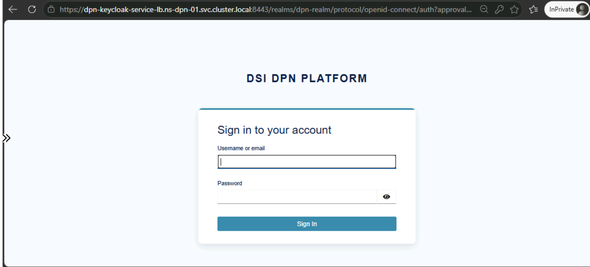
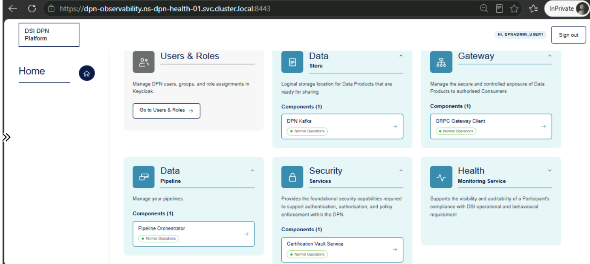

# DPN Portal User Guide

> **Audience:** Operations and data team members who need a single, Keycloak-authenticated entry point into DPN's observability UIs.

---

## Table of Contents

1. [What is the DPN Portal?](#1-what-is-the-dpn-portal)
2. [Accessing the Portal](#2-accessing-the-portal)
3. [Tiles](#3-tiles)
4. [Access Control (Keycloak Groups)](#4-access-control-keycloak-groups)
5. [Troubleshooting](#5-troubleshooting)

---

## 1. What is the DPN Portal?

The DPN Portal is a single landing page linking out to every DPN service UI, grouped into cards, served over **HTTPS**. It replaces separately bookmarking each UI's own address with one authenticated starting point.

## 2. Accessing the Portal

DPN users need to open the DPN Unified portal user interface from the following FQDN. This is internal kubernetes FQDN and only accessible from a private network windows VM in the same VNET of the DPN Kubernetes cluster

```text
https://dpn-observability.<namespace>.svc.cluster.local:<portal-port>
```

Signing in redirects through the Keycloak login page. 



Once authenticated, the landing page lists tiles based on the user role assigned to you.



## 3. Tiles

The landing page is organised into **cards**, not a flat tile grid. Each card groups one or more named **components**, and each component is an independent link (see the screenshot in [§2](#2-accessing-the-portal)):

| Card | Component(s) | Links to | Purpose |
|------|--------------|----------|---------|
| Users & Roles | Keycloak Console | The Keycloak admin console (dpn-realm realm) | Manage DPN users, groups, and role assignments — admin-only, see §4. Not shown in the screenshot above, since it was captured as a `dpnreader` user |
| Data / Store (top-left card in the screenshot) | DPN Kafka | The health-monitoring Kafka UI | Browse topics and manage the Kafka clusters — see [Kafka UI Operations](04-kafka-ui-operations.md) / [Kafka Health UI Operations](07-kafka-health-ui-operations.md) |
| Gateway (top-middle card) | GRPC Gateway Client | The gRPC gateway client UI, once deployed | Manage exposure of Data Products to authorised consumers |
| Data / Pipeline (top-right card) | Pipeline Orchestrator | Apache Airflow | Monitor and manage the DPN data-pipeline DAGs — see [Airflow Scheduler UI Operations](02-apache-airflow-scheduler-ui-operations.md) |
| Security / Services (bottom-left card) | Certification Vault Service | The Vault UI, once deployed | Foundational authentication/authorisation/policy-enforcement service |
| Health / Monitoring Service (bottom-right card) | Log Stack, Traces Stack, Metrics Dashboard, Collector Stack | OpenSearch Dashboards, Jaeger, Perses, Kafka UI respectively | Visibility into a participant's operational and compliance posture — see [OpenSearch Dashboard Operations](05-opensearch-dashboard-ui-operations.md), [Jaeger Dashboard Operations](06-jaeger-dashboard-ui-operations.md) |

Each component opens its target UI directly over its own HTTPS address — the portal is a directory, not a reverse proxy for these UIs' content. Two notes on the table above:

- **Collector Stack and DPN Kafka currently point at the same Kafka UI instance.** They are listed as separate components (one under "Data / Store", one under "Health / Monitoring Service") because they represent two different *purposes* for reaching that UI, not two different services.
- **Gateway and Security / Services ship with no URL configured today.** Their components render as a non-clickable "No status available" row until a GRPC Gateway Client / Vault UI address is deployed and wired into the portal's `tiles` values for that environment — this is a placeholder for services not yet exposed through the portal, not a bug. In the screenshot above, both cards instead show their one component in "Normal Operations" for this environment.

## 4. Access Control (Keycloak Groups)

Card visibility is filtered by the Keycloak group(s) in the `X-Forwarded-Groups` header. Two groups exist today:

| Role | Group | Intended for |
|------|-------|--------------|
| dpnadmin | `dpn-admins` | Administrators |
| dpnreader | `dpn-readers` | Read-only operational users |

**Users & Roles is admin-only** — its card lists only `dpn-admins` in `groups`, so `dpn-readers` users never see it or the Keycloak Console link. Every other card lists both groups and is visible to all authenticated users; per-card `groups` remains the mechanism for tightening any of them further if a service should become admin-only later — that is a configuration change to the card's `groups` list, not a code change.

## 5. Troubleshooting

| Symptom | Cause | Fix |
|---|---|---|
| Redirected to Keycloak repeatedly, never reaches the portal | Session cookie rejected or Keycloak client misconfigured | Confirm the portal's oauth2-proxy client is registered correctly in the `dpn-realm` realm and that its redirect URI matches the portal's HTTPS address |
| A card or component is missing | Your Keycloak group isn't in that card's allowed `groups` list (expected for `dpnreader` on Users & Roles), or the component's URL is unset for this environment | Check your assigned Keycloak groups; check the portal chart's `tiles` values for that environment for the component's URL |
| Signing out of the portal doesn't sign you out of every UI immediately | Each UI's oauth2-proxy release keeps its own separate session cookie; the portal's sign-out page fires a logout beacon at every other release's URL, but a UI's own cookie only re-checks Keycloak on its next `cookie_refresh` (30 minutes) | Wait for that UI's own session to refresh, or sign out of it directly — signing out via the portal ends the shared Keycloak SSO session immediately even if an individual UI's local cookie lingers briefly |
