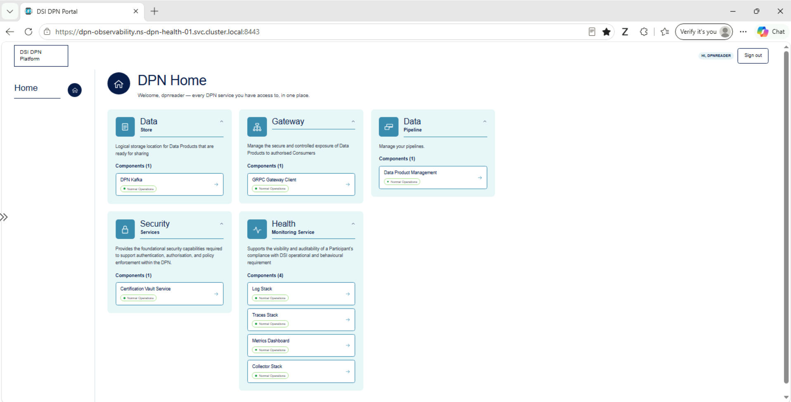
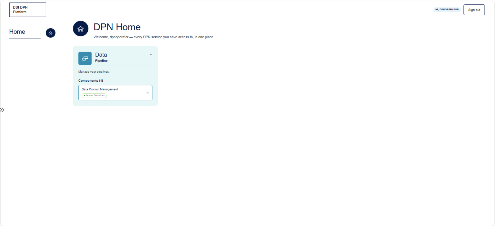

Release : 2.1.0 - Oct 2026

# DPN Portal User Guide

> **Audience:** Operations and data team members who need a single, Keycloak-authenticated entry point into DPN's observability UIs.

---

## Table of Contents

1. [What is the DPN Portal?](#1-what-is-the-dpn-portal)
2. [Accessing the Portal](#2-accessing-the-portal)
3. [Tiles](#3-tiles)
4. [Access Control (Keycloak Groups)](#4-access-control-keycloak-groups)
5. [Troubleshooting](#5-troubleshooting)

---

## 1. What is the DPN Portal?

The DPN Portal is a single landing page linking out to every DPN service UI, grouped into cards, served over **HTTPS**. It replaces separately bookmarking each UI's own address with one authenticated starting point.

## 2. Accessing the Portal

DPN users need to open the DPN Unified portal user interface from the following FQDN. This is internal kubernetes FQDN and only accessible from a private network windows VM in the same VNET of the DPN Kubernetes cluster

```text
https://dpn-observability.<namespace>.svc.cluster.local:<portal-port>
```

Signing in redirects through the Keycloak login page. 


Once authenticated, the landing page lists tiles based on the Keycloak group you belong to. The screenshot below is the view of the user `dpnadmin` (member of the `dpn-admins` group), which shows every card (see [Section 4](#4-access-control-keycloak-groups)):


The user `dpnreader` (member of the `dpn-readers` group) sees every card except Users & Roles (see [Section 4](#4-access-control-keycloak-groups)):



The user `dpnoperator` (member of the `dpn-operators` group) sees only the Data / Pipeline card (see [Section 4](#4-access-control-keycloak-groups)):



## 3. Tiles

The landing page is organised into **cards**, not a flat tile grid. Each card groups one or more named **components**, and each component is an independent link (see the screenshot in [Section 2](#2-accessing-the-portal)):

| Card | Component(s) | Links to | Purpose |
|------|--------------|----------|---------|
| Users & Roles | Keycloak Console | The Keycloak admin console (dpn-realm realm) | Manage DPN users, groups, and role assignments — admin-only, see Section 4. Top-left card in the `dpnadmin` screenshot above; not shown to the `dpnreader` or `dpnoperator` users (members of `dpn-readers` / `dpn-operators`) |
| Data / Store (top-middle card) | DPN Kafka | The health-monitoring Kafka UI | Browse topics and manage the Kafka clusters — see [Kafka UI Operations](04-kafka-ui-operations.md) / [Kafka Health UI Operations](07-kafka-health-ui-operations.md) |
| Gateway (top-right card) | GRPC Gateway Client | The gRPC gateway client UI (HTTPS) | Manage exposure of Data Products to authorised consumers |
| Data / Pipeline (bottom-left card) | Data Product Management | The DPN self-service portal (`dpn-self-service-external`) | Manage your data pipelines through the self-service portal, which replaced Airflow on this card. Also the only card visible to the `dpnoperator` user (member of `dpn-operators`) |
| Security / Services (bottom-middle card) | Certification Vault Service | The Vault UI | Foundational authentication/authorisation/policy-enforcement service |
| Health / Monitoring Service (bottom-right card) | Log Stack, Traces Stack, Metrics Dashboard, Collector Stack | OpenSearch Dashboards, Jaeger, Perses, Kafka UI respectively | Visibility into a participant's operational and compliance posture — see [OpenSearch Dashboard Operations](05-opensearch-dashboard-ui-operations.md), [Jaeger Dashboard Operations](06-jaeger-dashboard-ui-operations.md) |

Each component opens its target UI directly over its own HTTPS address — the portal is a directory, not a reverse proxy for these UIs' content.

## 4. Access Control (Keycloak Groups)

Card visibility is filtered by the Keycloak group(s) in the `X-Forwarded-Groups` header. Three groups exist today:

| Role | Group | Intended for |
|------|-------|--------------|
| dpnadmin | `dpn-admins` | Administrators |
| dpnreader | `dpn-readers` | Read-only operational users |
| dpnoperator | `dpn-operators` | Pipeline operators — Data / Pipeline (Data Product Management) only |

**Users & Roles is admin-only** — its card lists only `dpn-admins` in `groups`, so `dpn-readers` users never see it or the Keycloak Console link. Every other card lists both `dpn-admins` and `dpn-readers` and is visible to all of those users, with one exception: Data / Pipeline also lists `dpn-operators`, and `dpn-operators` users see that card only. Per-card `groups` remains the mechanism for tightening any of them further if a service should become admin-only later — that is a configuration change to the card's `groups` list, not a code change.

## 5. Troubleshooting

| Symptom | Cause | Fix |
|---|---|---|
| Redirected to Keycloak repeatedly, never reaches the portal | Session cookie rejected or Keycloak client misconfigured | Confirm the portal's oauth2-proxy client is registered correctly in the `dpn-realm` realm and that its redirect URI matches the portal's HTTPS address |
| A card or component is missing | Your Keycloak group isn't in that card's allowed `groups` list (expected for `dpn-readers` on Users & Roles, and for `dpn-operators` on everything except Data / Pipeline), or the component's URL is unset for this environment | Check your assigned Keycloak groups; check the portal chart's `tiles` values for that environment for the component's URL |
| Signing out of the portal doesn't sign you out of every UI immediately | Each UI's oauth2-proxy release keeps its own separate session cookie; the portal's sign-out page fires a logout beacon at every other release's URL, but a UI's own cookie only re-checks Keycloak on its next `cookie_refresh` (30 minutes) | Wait for that UI's own session to refresh, or sign out of it directly — signing out via the portal ends the shared Keycloak SSO session immediately even if an individual UI's local cookie lingers briefly |
| A component shows "unavailable" (or no status) even though the underlying service is actually running and healthy | The component's configured URL points at a Kubernetes Service name/suffix (e.g. `dpn-federator-client-1-...`) that doesn't match what was actually deployed in that cluster (e.g. `dpn-federator-client-2-...`). The portal's availability check is probing a hostname with no matching Service, so it always reports unavailable regardless of the real service health | Confirm the actual deployed service name for that environment (`kubectl get svc -n <namespace> \| grep federator`), then update the URL under **both** `otherUIUrls:` and `tiles:` in `dpn-health-monitoring-service/charts/dpn-portal/values-dpn01.yaml` to match, and redeploy/resync the `dpn-portal` release |

> **Note:** This mismatch happens whenever the federator client/server is actually deployed with a different service-name suffix than the one assumed by the URLs in the values file used to configure the portal (see the [DNS naming convention](../03-dpn-application-deployment/aws-gha-beta/02-configuration/00-common-dpn-configuration.md#step6-dpn-internal-domain-naming-dns-configuration)). Always verify the deployed service's actual name/suffix first rather than assuming it matches the values file's naming — and remember to update **both** `otherUIUrls:` and `tiles:`, since either one being stale reproduces this symptom for the component(s) it feeds.
