# DPN Keycloak User Guide

> **Audience:** Administrator of Operations team to manage (create/update/delete) users for DPN UI interfaces.

---

## Table of Contents

1. [What is the DPN Keycloak?](#1-what-is-the-dpn-keycloak)
2. [Accessing the Portal](#2-accessing-the-portal)
3. [User Management in DPN Keycloak](#3-user-management-in-dpn-keycloak)
4. [Audit Events](#4-audit-events)

---

## 1. What is the DPN Keycloak?

The DPN Keycloak is an user interface which is used to manage users for accessing DPN UI components which are part of DPN Portal. The access to this DPN Keycloak UI is restricted to only administrator. The administrator will be able to following task in Keycloak UI
a) create new user
b) assign (unassign) user to(from) role
c) assign (unassign) user to(from) group
d) delete user


## 2. Accessing the Portal

```text
https://dpn-keycloak-service-lb.<namespace>.svc.cluster.local:<portal-port>
```
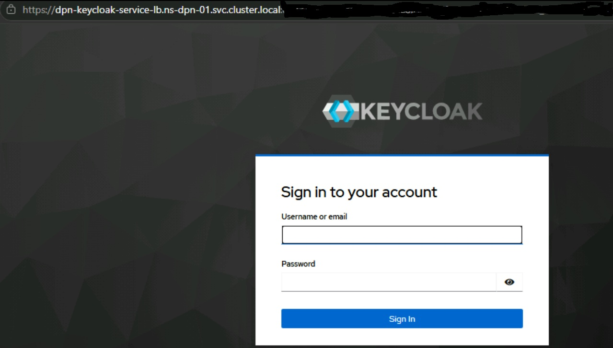

Use only adminstrator's credential to login.

a) After login administrator lands at default landing page
   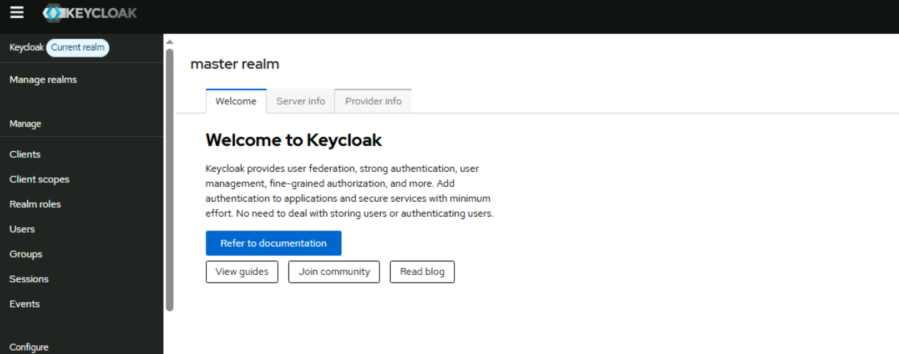
b) Go to Manage realms where all realms are listed
   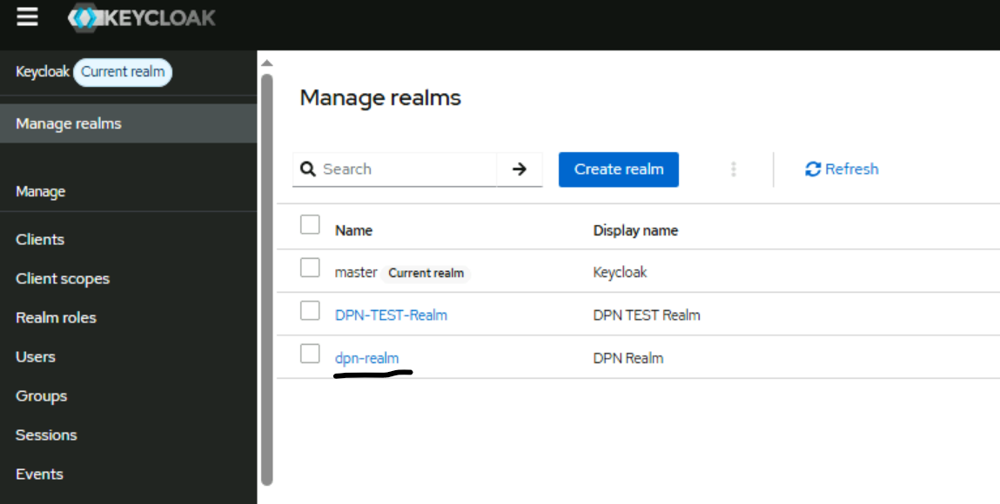
c) Choose dpn-realm as this is specifically pre-configured for dpn UI components. Once dpn-realm is selected user lands at
   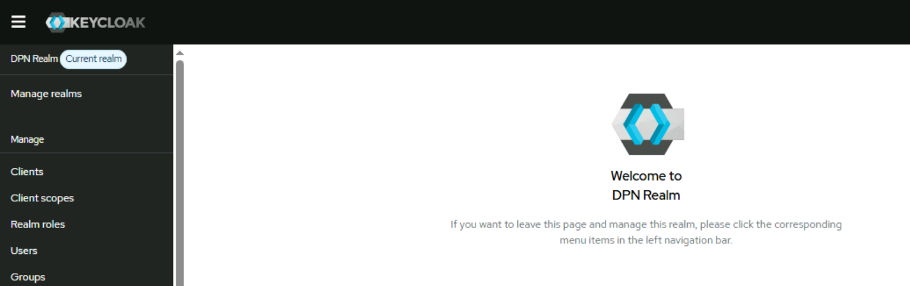
d) Click on Realm roles to see available pre-configured roles for dpn
   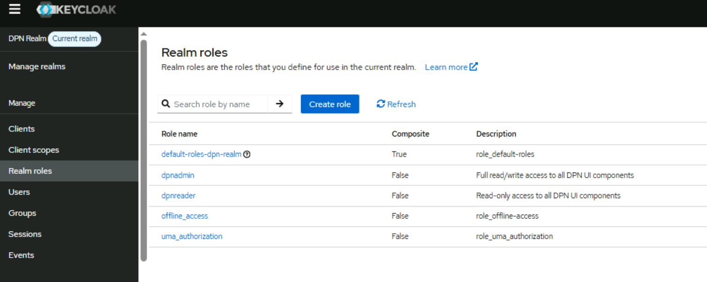
Note that dpnadmin and dpnreader roles are pre-configured for dpn. Rest of them are default roles.

## 3. User Management in DPN Keycloak

The user management activities involve user creation, user setting modification, user deletion.
a) User Creation: 
    i. Click on on Users on left panel
    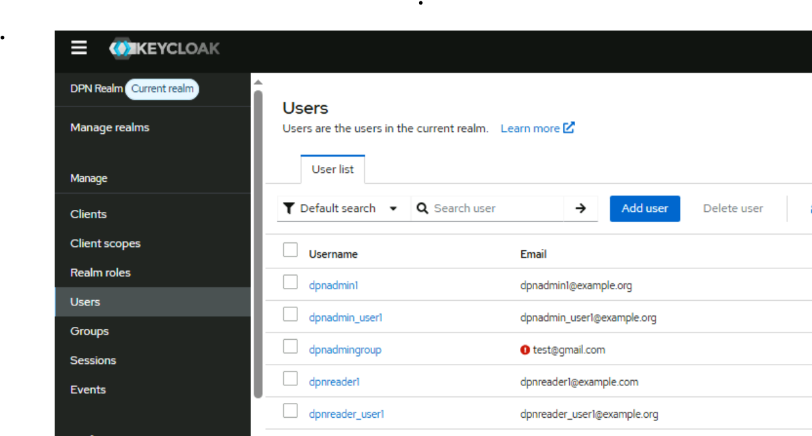
    ii. Click on Add user and fill out the required details in the respective fields (username, email, first name, last name). Mark email verfied as on. Then click on Create.
    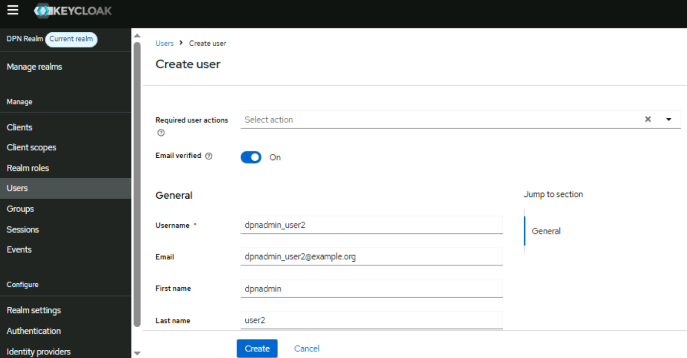
    iii. Move to Credential tab. Click on Set password
    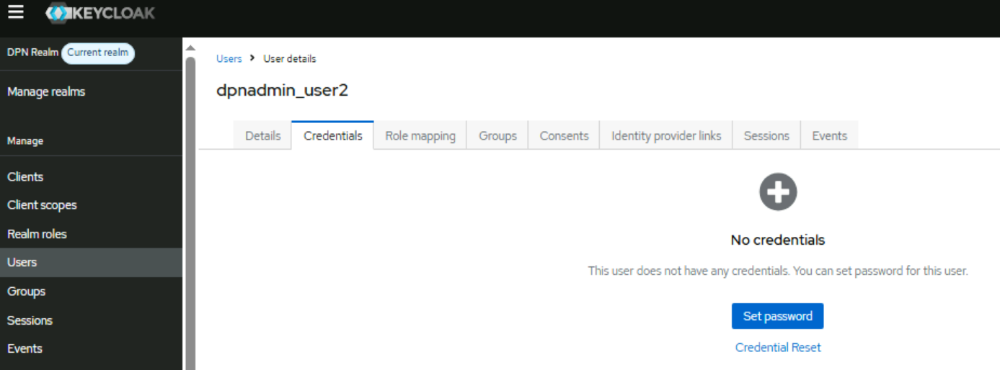
    iv. Set password and mark Temporary as off and then save it
    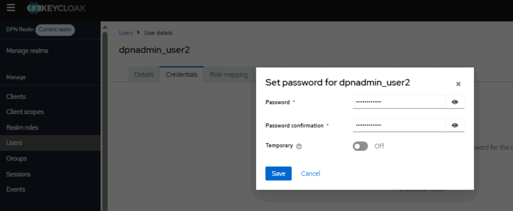
    v. Move to Role Mapping. This is where user is attached to a role. Click on Assign Role and choose Realm roles from dropdown.
    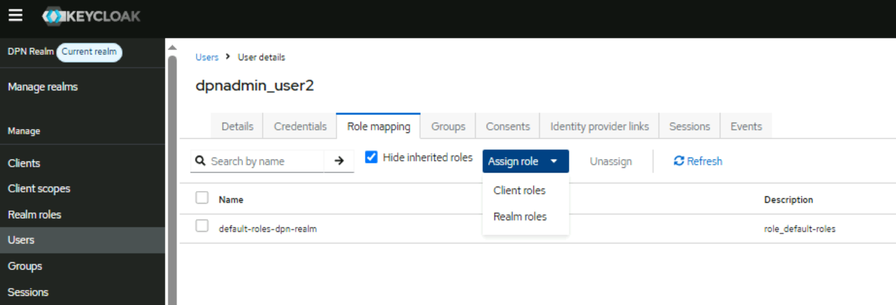
    vi. Select dpnadmin or dpnreader as the role. If the user is expected to perform read/write activities then choose dpnadmin as role. If user is expected to have view ability then choose dpnreader as role.
    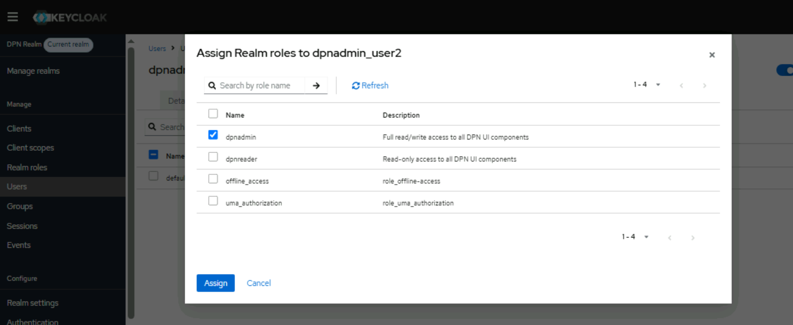
    vii. Move to group allocation. This is where user is made part of any of the already created groups. For dpnadmin role users select dpn-admins or select dpn-readers for dpnreader role users.
    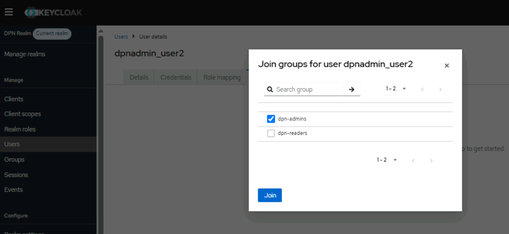
    Once above steps are performed then save it.Following the above steps the administrator of DPN Keycloak create a new user, sets credential , assign to a role and its corresponding group.
    Upon creation of user the user now becomes available to use for DPN UI portals.

b) User modification:
    i. Choose any user which are already created.
    ii. Edit its settings. Administrator can assign/unassign the user to any new role or group. 

c) User Deletion:
    i. Choose any user which are already created. Select it and click on delete.
    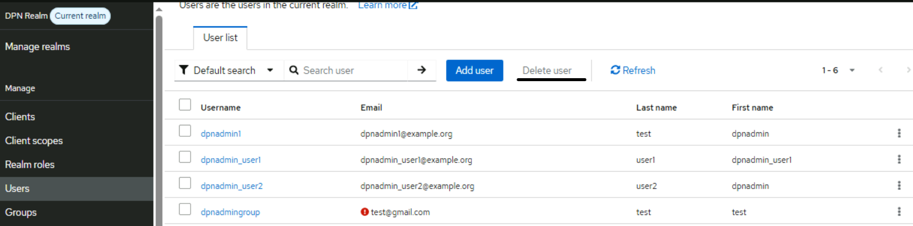


## 4. Audit Events

All the activities using any of the users which are created in DPN Keycloak are tracked and persisted. The past activities
of users are available under Events section. Administrator can choose to go through non-admin user events
or admin user events.
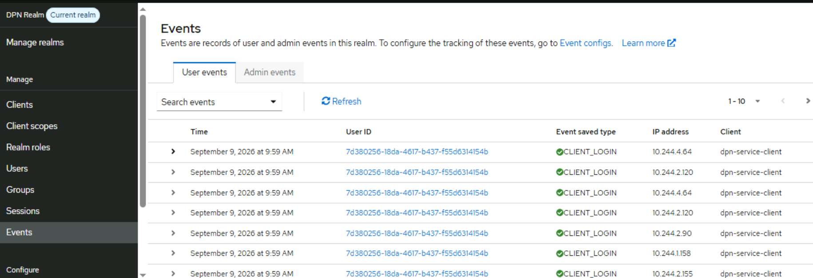
By clicking on any particular event it provides detailed information about that particular event.
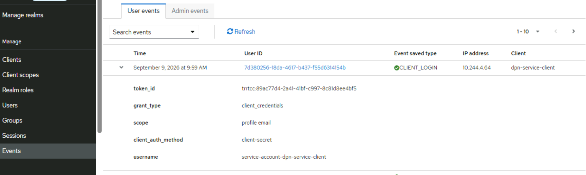
