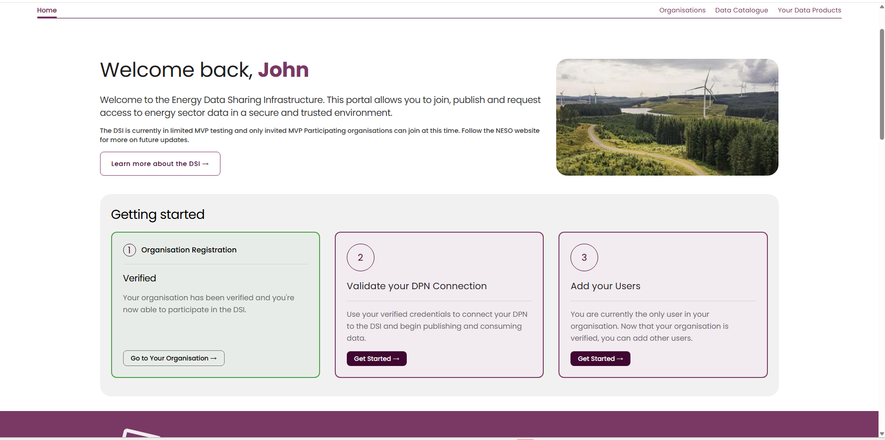
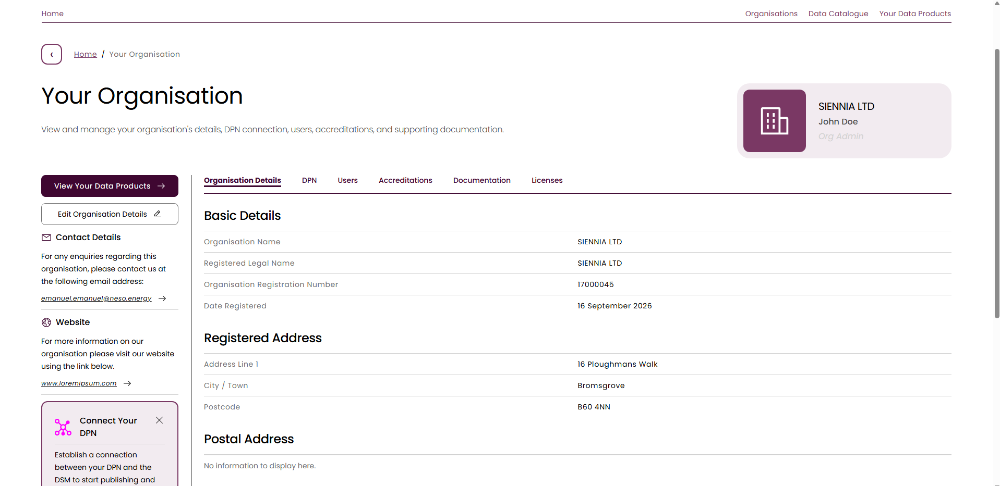
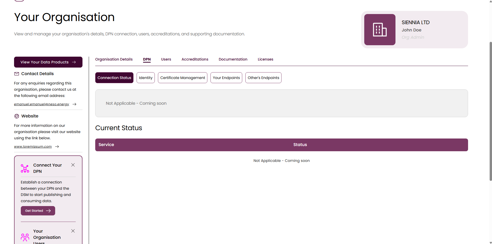
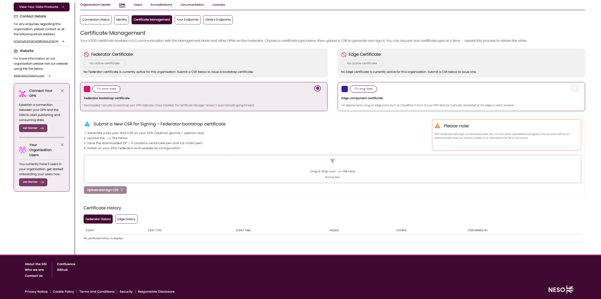
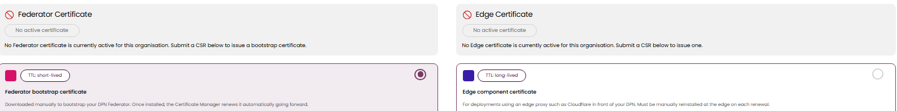
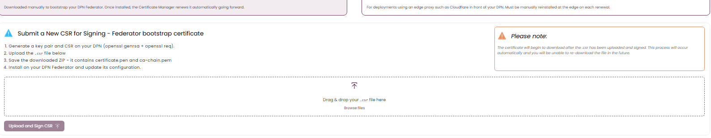
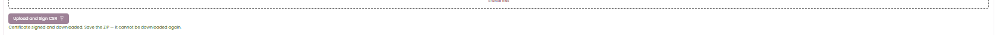
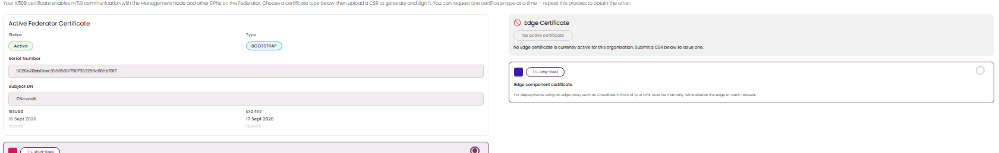
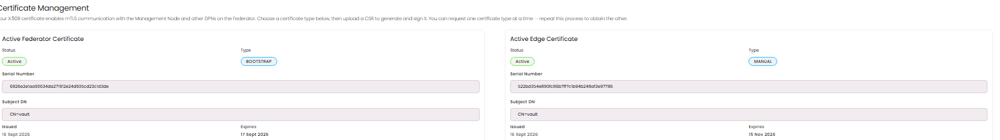
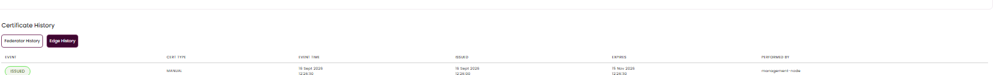

# DSI Certificate Management UI Guide

> **Audience:** Org Admins issuing or renewing their organisation's DPN certificates through the DSI portal.

---

## Table of Contents

1. [What is DSI Certificate Management?](#1-what-is-dsi-certificate-management)
2. [The Two Certificate Types](#2-the-two-certificate-types)
3. [Walkthrough: Issuing a Certificate](#3-walkthrough-issuing-a-certificate)
4. [Auditing Certificate History](#4-auditing-certificate-history)

---

## 1. What is DSI Certificate Management?

Every DPN node's X.509 certificate — whether it bootstraps the gRPC/REST Federator or fronts an edge proxy — is generated and signed from a single page in the DSI portal: **Your Organisation → DPN → Certificate Management**. An Org Admin uploads a CSR generated on their own DPN; the portal signs it and returns a one-time-downloadable bundle to install.

This is a portal (DSI/DSM) operation, separate from the DPN-side deployment steps covered elsewhere in this playbook — it produces the certificate bundle that [Configure DPN Vault Service, Step 3C](../03-dpn-application-deployment/azure-ado-beta/02-configuration/01-configure-dpn-vault-service.md#step-3c-configure-certificate-bundle-vault-load-bundle-cd) then loads into Vault.

You must already be signed in to the DSI portal as **Org Admin**, with your organisation's registration **Verified**, before starting.

## 2. The Two Certificate Types

Only one type can be requested at a time from the same panel — repeat the process to obtain the other. Issuing one never disturbs the other; each has its own independent status, history, and lifecycle.

| | Federator bootstrap certificate | Edge component certificate |
|---|---|---|
| TTL | **Short-lived** | **Long-lived**, platform-configured |
| Portal `Type` value | `BOOTSTRAP` | `MANUAL` |
| Purpose | Bootstraps your DPN Federator manually | For deployments fronted by an edge proxy (e.g. Cloudflare) |
| Renewal | Once installed, the **Certificate Manager renews it automatically** going forward | Must be **manually reinstated at the edge** on each renewal — there is no automated renewal path |

## 3. Walkthrough: Issuing a Certificate

**Step 1 — Go to Your Organisation.** From the Home dashboard, the "Getting started" cards include **Organisation Registration**, which must already show **Verified**. Click **"Go to Your Organisation →"**.

**Step 2 — Open the DPN tab.** "Your Organisation" opens on **Organisation Details** by default. Click the **DPN** tab.

**Step 3 — Open Certificate Management.** The DPN tab defaults to **Connection Status**, alongside sub-tabs Identity, Certificate Management, Your Endpoints, Other's Endpoints. Click **Certificate Management**.

**Step 4 — Review the page with no active certificate.** With nothing issued yet, both the Federator and Edge cards read "No active certificate," and the Certificate History table reads "No certificate history to display." The Edge option is always visible and selectable, independent of whether a Federator certificate exists.

**Step 5 — Choose a certificate type.** Select **Federator bootstrap certificate** (short-lived) or **Edge component certificate** (long-lived).

**Step 6 — Generate, upload, and sign the CSR.**
1. On your own DPN, generate a key pair and `.csr` file: `openssl genrsa` + `openssl req`.
2. With the desired type selected, drag & drop the `.csr` file into the panel (or Browse Files).
3. Click **Upload and Sign CSR**.

An invalid or malformed `.csr` is rejected immediately with a validation error — no certificate is issued in that case.

> **The signed bundle downloads exactly once.** On success, a ZIP containing `certificate.pem` and `ca-chain.pem` downloads automatically. **Save it immediately — it cannot be downloaded again.** Install it on your DPN Federator (Bootstrap) or edge component (Edge), then update its configuration.

**Step 7 — Confirm the certificate is active.** The corresponding card now shows `Status: Active`, its `Type` (`BOOTSTRAP` or `MANUAL`), Serial Number, Subject DN, and Issued/Expires dates.

**Step 8 — Repeat for the other type, if needed.** Select the other certificate's radio button, upload its own `.csr` into the same panel, and sign it the same way. Once both have been issued, both Active cards are shown side by side — each with its own Serial Number, Subject DN, and Issued/Expires dates.

## 4. Auditing Certificate History

The **Certificate History** table sits below the two certificate cards, with **Federator History** and **Edge History** tabs — each shows only its own events, never mixed. Columns: Event, Cert Type, Event Time, Issued, Expires, Performed by. Events are listed most-recent-first as more are issued, and `Performed by` attributes each action to the management-node. A type with no history yet shows "No certificate history to display" rather than an empty table.

---

## Review Notes

| Review Date | Last Reviewed By | Status | Semver Version (Major.Minor.Patch) |
|-------------|------------------|--------|-------------------------------------|
| 31-July-2026 | DSI Assurance    | Final  | V1.0.0 |
