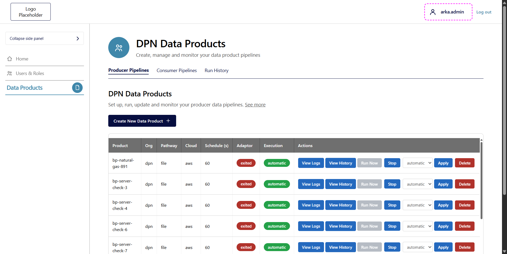
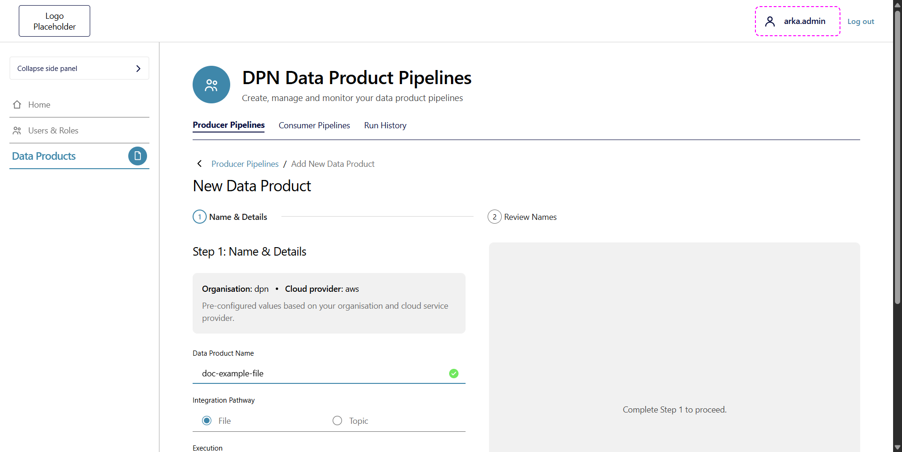
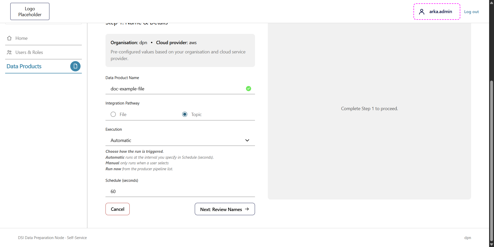
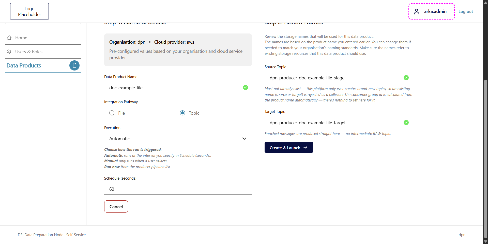
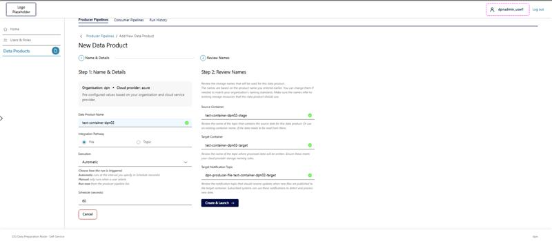
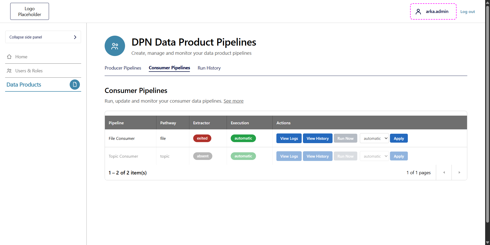
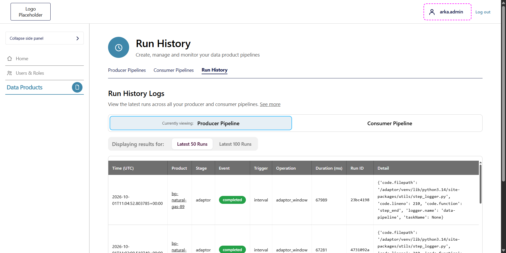
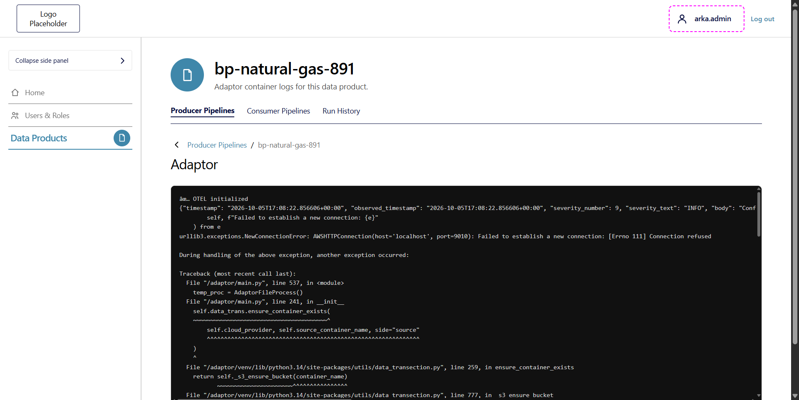

# DPN Data Products User Interface Guidance for Data Pipeline Operations

## Table of Contents

- [Purpose](#purpose)
  - [Accessing the DPN Data Products UI](#accessing-the-dpn-data-products-ui)
- [Figure 1: Producer Pipelines](#figure-1-producer-pipelines)
  - [Purpose](#purpose-1)
  - [Figure 1 - Point 1: Page Tabs](#figure-1---point-1-page-tabs)
  - [Figure 1 - Point 2: Create New Data Product](#figure-1---point-2-create-new-data-product)
  - [Figure 1 - Point 3: Data Product Table](#figure-1---point-3-data-product-table)
  - [Figure 1 - Point 4: Row Actions](#figure-1---point-4-row-actions)
  - [Execution Modes](#execution-modes)
  - [Create New Data Product Form](#create-new-data-product-form)
    - [Step 1: Name & Details](#step-1-name--details)
    - [Case 1: Topic-Based Data Product](#case-1-topic-based-data-product)
    - [Case 2: File-Based Data Product](#case-2-file-based-data-product)
- [Figure 2: Consumer Pipelines](#figure-2-consumer-pipelines)
  - [Purpose](#purpose-2)
  - [Figure 2 - Point 1: Consumer Pipeline Table](#figure-2---point-1-consumer-pipeline-table)
- [Figure 3: Run History](#figure-3-run-history)
  - [Purpose](#purpose-3)
  - [Figure 3 - Point 1: Producer and Consumer Selection](#figure-3---point-1-producer-and-consumer-selection)
  - [Figure 3 - Point 2: Run Count](#figure-3---point-2-run-count)
  - [Figure 3 - Point 3: Run History Table](#figure-3---point-3-run-history-table)
- [Figure 4: Adaptor Logs](#figure-4-adaptor-logs)
  - [Purpose](#purpose-4)
- [Troubleshooting Workflow](#troubleshooting-workflow)
- [Quick Validation Checklist](#quick-validation-checklist)
- [Review Notes](#review-notes)

---

## Purpose

This playbook explains how to use the **DPN Data Products** page to:

- See the Producer and Consumer data pipelines that exist.
- See whether each pipeline adaptor or extractor is running.
- Choose whether a pipeline runs automatically or manually.
- Review the latest pipeline runs.
- Read the adaptor container logs of a data product.

The page is titled **DPN Data Products** and is footed with **DSI Data Preparation Node · Self-Service**.

### Accessing the DPN Data Products UI

The page is opened through an OAuth2 proxy that signs users in with Keycloak.

1. Open the DPN Data Products address in your browser.
2. If you are not signed in, the **Sign in to your account** page of the `dpn-realm` realm opens.
3. Enter **Username or email** and **Password**, then click **Sign In**.
4. The **DPN Data Products** page opens on the **Producer Pipelines** tab.

The signed-in user name and a **Log out** link are shown at the top right of every page.

The **Logo Placeholder** box at the top left of every page links to the Unified dashboard. Click it to go there. Any company or organisation can replace the placeholder with its own logo or branding.

When you click the logo, the browser goes to the DPN observability address (`https://dpn-observability.<namespace>.svc.cluster.local:8443/`). This is the same address as the **Home** link in the left menu. See the [DPN Portal guide](08-dpn-portal-ui-operations.md).

The left menu has **Home**, **Users & Roles** and **Data Products**. **Home** opens the DPN observability portal. **Users & Roles** opens the Keycloak admin console. **Data Products** opens this page.

---

# Figure 1: Producer Pipelines

## Purpose

Use this page to see and control the Producer data pipelines of your organisation.

---

## Figure 1 - Point 1: Page Tabs

The page has three tabs:

- **Producer Pipelines**
- **Consumer Pipelines**
- **Run History**

The selected tab is underlined.

---

## Figure 1 - Point 2: Create New Data Product

The **Create New Data Product** button opens the **New Data Product** form.

---

## Figure 1 - Point 3: Data Product Table

The table lists one row for each data product.

| Column | What it shows | Values seen |
|---|---|---|
| **Product** | The data product name | `bp-natural-gas-891`, `bp-server-check-3`, `test-product` |
| **Org** | The organisation | `dpn` |
| **Pathway** | How data enters the pipeline | `file` |
| **Cloud** | The cloud provider | `aws` |
| **Schedule (s)** | The run interval in seconds | `60` |
| **Adaptor** | The state of the adaptor | `exited` |
| **Execution** | How runs are started | `automatic` |
| **Actions** | The buttons for the row | See Point 4 |

The footer of the table shows the item count, for example `1 – 10 of 10 item(s)`, and **Previous page** and **Next page** buttons.

### Verification

Expected:

- The data product is listed.
- **Adaptor** shows the state you expect.

If **Adaptor** shows `exited`, open **View Logs** to find out why. See [Figure 4](#figure-4-adaptor-logs).

---

## Figure 1 - Point 4: Row Actions

| Button | What it does |
|---|---|
| **View Logs** | Opens the adaptor container logs for the data product. |
| **View History** | Opens **Run History** filtered to the data product. |
| **Run Now** | Starts a run. It is disabled while **Execution** is `automatic`. Its hover text is "Set Execution to manual below to enable this." |
| **Stop** | Stop button for the pipeline. Not tested. |
| **automatic / manual** list with **Apply** | Changes **Execution**. Select a value, then click **Apply**. |
| **Delete** | Deletes the data product. |

Use **Stop**, **Apply** and **Delete** with care. They change the pipeline.

---

## Execution Modes

The hover text of the **Execution** list explains the two modes:

- **automatic** runs every 60 seconds on its own. The number is the **Schedule (s)** of the product.
- **manual** runs only when a user clicks **Run Now**.

To start a run by hand:

1. Select **manual** in the list of the data product.
2. Click **Apply**.
3. Click **Run Now**.

---

## Create New Data Product Form

Click **Create New Data Product** to open the **New Data Product** form. The form has two steps: **Name & Details** and **Review Names**. The two steps are shown side by side. The right side shows "Complete Step 1 to proceed." until Step 1 is done.

### Step 1: Name & Details

| Item | Description |
|---|---|
| **Organisation** | Shown as read only. Value seen: `dpn`. It is set from your organisation. |
| **Cloud provider** | Shown as read only. Value seen: `aws`. It is set from your cloud service provider. |
| **Data Product Name** | Required text box. When the name is accepted, a green tick appears at the end of the box. |
| **Integration Pathway** | Choose **File** or **Topic**. **File** is selected by default. |
| **Execution** | **Automatic** or **Manual**. **Automatic** is the default. **Automatic** runs at the interval in **Schedule (seconds)**. **Manual** runs only when a user clicks **Run now** in the producer pipeline list. |
| **Schedule (seconds)** | Required number. Default `60`. Allowed range `5` to `3600`. |

Click **Cancel** to return to **Producer Pipelines**. Click **Next: Review Names** to continue. The button appears after a name is entered. While the page prepares the next step, the button is disabled.

The fields in Step 1 are the same for **File** and **Topic**. Only Step 2 is different: **File** asks for a source container, a target container and a notification topic, while **Topic** asks for a source topic and a target topic.

### Case 1: Topic-Based Data Product

1. Enter a **Data Product Name**. The example used here is `doc-example-file`.
2. Select **Topic** under **Integration Pathway**.
3. Leave **Execution** as **Automatic** and **Schedule (seconds)** as `60`, or change them.
4. Click **Next: Review Names**.

Step 2 opens on the right side of the page.

**Step 2: Review Names** reads: "Review the storage names that will be used for this data product." The names are based on the product name. You can change them to match your organisation's naming standards. The names must refer to the resources this data product should use.

| Field | Value shown for `doc-example-file` | Description |
|---|---|---|
| **Source Topic** | `dpn-producer-doc-example-file-stage` | Required. It must not already exist. The platform only creates brand-new topics, so an existing source or target name is rejected as a collision. The consumer group id is calculated from the product name. There is nothing to set for it. |
| **Target Topic** | `dpn-producer-doc-example-file-target` | Required. Enriched messages are produced straight to this topic. There is no intermediate RAW topic. |

A green tick appears at the end of each name when the name is accepted.

The last button is **Create & Launch**. Click it only when you want to create the data product.

### Case 2: File-Based Data Product

1. Enter a **Data Product Name**. The example used here is `test-container-dpn02`.
2. Keep **File** selected under **Integration Pathway**. It is the default.
3. Leave **Execution** as **Automatic** and **Schedule (seconds)** as `60`, or change them.
4. Click **Next: Review Names**.

Step 2 opens on the right side of the page, next to Step 1. The example above uses the product name `test-container-dpn02`.

**Step 2: Review Names** reads: "Review the storage names that will be used for this data product." The names are based on the product name you entered earlier. You can change them to match your organisation's naming standards. The names must refer to the storage resources this data product should use.

| Field | Value shown for `test-container-dpn02` | Description |
|---|---|---|
| **Source Container** | `test-container-dpn02-stage` | Required. The container the data product reads its source files from. |
| **Target Container** | `test-container-dpn02-target` | Required. The container where processed files are written. |
| **Target Notification Topic** | `dpn-producer-file-test-container-dpn02-target` | Required. The topic that receives a message when a new file is written to the target container. Subscribed systems use these messages to detect and process new data. |

A green tick appears at the end of each name when the name is accepted.

The last button is **Create & Launch**. Click it only when you want to create the data product. This guide did not click it.

---

# Figure 2: Consumer Pipelines

## Purpose

Use this page to see and control the Consumer data pipelines.

---

## Figure 2 - Point 1: Consumer Pipeline Table

The table has one row for each consumer pipeline.

| Pipeline | Pathway | Extractor | Execution |
|---|---|---|---|
| **File Consumer** | `file` | `exited` | `automatic` |
| **Topic Consumer** | `topic` | `absent` | `automatic` |

Each row has **View Logs**, **View History**, **Run Now** and an **automatic / manual** list with **Apply**.

- **Run Now** is disabled while **Execution** is `automatic`. For **Topic Consumer** its hover text is "Not running."
- **Extractor** shows the state of the extractor. `absent` is the value shown for **Topic Consumer**.
- There is no **Create**, **Stop** or **Delete** button on this page.

---

# Figure 3: Run History

## Purpose

Use this page to review the latest runs of all producer and consumer pipelines.

---

## Figure 3 - Point 1: Producer and Consumer Selection

**Currently viewing** shows **Producer Pipeline** or **Consumer Pipeline**. Click the other name to switch.

---

## Figure 3 - Point 2: Run Count

**Displaying results for** offers **Latest 50 Runs** and **Latest 100 Runs**.

---

## Figure 3 - Point 3: Run History Table

| Column | What it shows |
|---|---|
| **Time (UTC)** | When the step was recorded |
| **Product** | The data product. Click it to filter the table to that product. |
| **Stage** | The pipeline stage. Value seen: `adaptor` |
| **Event** | The result of the step. Value seen: `completed` |
| **Trigger** | What started the run. Value seen: `interval` |
| **Operation** | The operation. Value seen: `adaptor_window` |
| **Duration (ms)** | Shows how long a pipeline step took to complete, measured in milliseconds (1,000 ms = 1 second). |
| **Cycle** | A cycle is one complete pipeline run where the system wakes up, performs its task, records a summary in Run History, and stops, regardless of what triggered it. |
| **Run ID** | A short run identifier |
| **Detail** | Extra log details |

Opening **View History** from a data product row shows the same table filtered to that product.

### Verification

Expected:

- A row exists for each run.
- **Event** shows `completed`.
- **Duration (ms)** is in a normal range for the product.

---

# Figure 4: Adaptor Logs

## Purpose

Click **View Logs** on a producer row to open the log page of the data product. The page title is the product name, for example `bp-natural-gas-891`, and the text reads "Adaptor container logs for this data product."

The **Adaptor** section shows the raw log output of the adaptor container. Use the breadcrumb, **Producer Pipelines / <product name>**, or **Back** to return to the list.

For `bp-natural-gas-891`, the log shows a connection error. The adaptor could not connect to its source storage endpoint, which matches the `exited` state in the table. Use the last lines of the log to find the reason a pipeline stopped.

---

# Troubleshooting Workflow

## Step 1: Check the Pipeline State

Open **Producer Pipelines** or **Consumer Pipelines**.

Check:

- **Adaptor** or **Extractor** state
- **Execution** mode

## Step 2: Read the Logs

Click **View Logs** for the pipeline.

Check:

- The last lines of the log
- Connection or configuration errors

## Step 3: Check the Run History

Click **View History** for the pipeline.

Check:

- **Event** is `completed`
- **Duration (ms)**
- **Trigger** is as expected

---

# Quick Validation Checklist

- [ ] The sign-in to `dpn-realm` works.
- [ ] The data product is listed on **Producer Pipelines**.
- [ ] **Execution** is set as intended.
- [ ] **Adaptor** or **Extractor** state is understood.
- [ ] **Run History** shows `completed` runs.
- [ ] No connection errors appear in **View Logs**.

---

# Review Notes

| Review Date | Last Reviewed By | Status | Version |
|-------------|-----------------|--------|---------|
| Pending | Pending | Draft | V1.0.0 |
